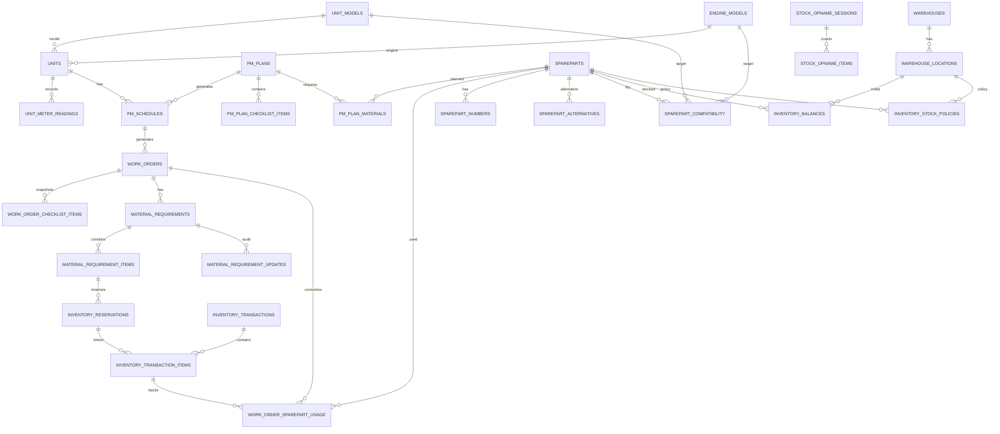

# Data Model — GSI Work Order & Maintenance

**Status:** Proposal untuk M1+ (bukan migrasi, bukan klaim implemented)
**Baseline:** Milestone 0 — 15 tabel aplikasi + `schema_migrations` (locked)
**Sumber requirement:** `prds/2026-11-18_work-order-maintenance-gsi.md`
**Aturan bisnis:** `docs/Domain Rules.md`

> Dokumen ini adalah **desain teknis**. DDL di bawah belum dijalankan. Implementasi wajib melalui migration baru `golang-migrate` dan approval milestone. Migrasi M0 **tidak boleh** diubah.

---

## 1. Prinsip model data

1. **Satu sumber kebenaran per konsep.** Tabel history/usage/adjustment tidak diduplikasi bila dapat menjadi view atau tipe transaksi.
2. **Ledger immutable.** `inventory_transactions` + `inventory_transaction_items` adalah sumber kebenaran saldo; item/qty posted tidak diubah/dihapus, hanya status `posted → reversed` saat reversal. `inventory_balances` hanya cache yang dapat dibangun ulang.
3. **Snapshot pada WO.** Checklist PM disalin saat WO dibuat; material plan disalin menjadi material requirement saat modul material aktif (M6); perubahan template tidak mengubah history.
4. **Master + transaksi.** Master unit/sparepart/inventory/PM terpisah dari transaksi.
5. **UTC + DATE.** Event memakai `TIMESTAMPTZ`; tanggal bisnis memakai `DATE`.
6. **Migration additive.** Migrasi 000001/000002 tidak diubah; perluasan memakai migration baru (`CREATE TABLE`, `ALTER TABLE ADD COLUMN`/`ADD CONSTRAINT`, perluasan CHECK). Tidak ada drop table/column data existing.
7. **No costing.** Tidak ada harga, cost, valuation, vendor price, atau data procurement.

### 1.1 Status vocabulary

Nilai DB memakai `snake_case`; label UI memakai Title Case.

| Domain | Nilai DB | Label UI |
|---|---|---|
| Compatibility | `pending_verification` | Pending Verification |
| Compatibility | `approved_compatible` | Approved Compatible |
| Compatibility | `conditional_compatible` | Conditional Compatible |
| Compatibility | `not_compatible` | Not Compatible |
| Material | `draft`, `planned`, `checking_stock`, `ready`, `partially_ready`, `shortage`, `reserved`, `issued`, `completed`, `cancelled` | Draft, Planned, Checking Stock, Ready, Partially Ready, Shortage, Reserved, Issued, Completed, Cancelled |
| PM schedule | `scheduled`, `due`, `overdue`, `wo_created`, `completed`, `skipped`, `cancelled` | Scheduled, Due, Overdue, WO Created, Completed, Skipped, Cancelled |
| WO | `open`, `in_progress`, `waiting_part`, `done`, `cancelled` | Open, In Progress, Waiting Part, Done, Cancelled |

---

## 2. Baseline M0 schema (implemented & locked)

### 2.1 Tabel aplikasi (15)

| Tabel | PK | Relasi penting |
|---|---|---|
| `users` | `id` | `odoo_user_id` unik; role baseline 4 nilai |
| `employees` | `id` | `odoo_employee_id` unik; `user_id → users` |
| `units` | `id` | `odoo_unit_id` unik; `code` = no lambung |
| `p2h_reports` | `id` | `unit_id → units`; `odoo_report_id` unik |
| `p2h_findings` | `id` | `report_id → p2h_reports`; `odoo_line_id` unik |
| `wo_candidates` | `id` | `p2h_report_id → p2h_reports` unik; `unit_id → units` |
| `work_orders` | `id` | `unit_id → units`; `candidate_id → wo_candidates`; `p2h_report_id` unik |
| `wo_findings` | `(wo_id, finding_id)` | `wo_id → work_orders`; `finding_id → p2h_findings` |
| `wo_updates` | `id` | `wo_id → work_orders`; append-only |
| `wo_attachments` | `id` | `wo_id → work_orders` |
| `notifications` | `id` | `user_id → users` |
| `app_settings` | `key` | seed 3 setting |
| `app_settings_history` | `id` | `changed_by → users` |
| `sync_runs` | `id` | log sinkron |
| `sync_state` | `key` | cursor sinkron |

### 2.2 Constraint M0 yang relevan

* `work_orders.source CHECK (source IN ('p2h','manual'))` — akan diperluas ke `pm`.
* `work_orders.status CHECK (status IN ('open','in_progress','waiting_part','done','cancelled'))` — **reuse** `waiting_part`.
* `users.role CHECK (role IN ('admin','planner','mechanic','viewer'))` — akan ditambah `storekeeper`.
* `wo_candidates.status` sudah memiliki `archived`; `notified_at` sudah ada.
* Seed: `p2h_auto_wo=false`, `candidate_sla_hours=24`, `candidate_backfill_days=30`.

### 2.3 Index M0

`work_orders(status, priority)`, `work_orders(unit_id)`, `wo_candidates(status, created_at)`, `p2h_reports(unit_id, report_date DESC)`, `p2h_findings(report_id)`, `p2h_findings(category_norm)`, `notifications(user_id, read_at)`.

---

## 3. Peta domain & ERD

### 3.1 Peta domain

| Domain | Tabel |
|---|---|
| Identity & unit | `users`, `employees`, `unit_models`, `engine_models`, `units`, `components`, `unit_meter_readings` |
| P2H | `p2h_reports`, `p2h_findings`, `wo_candidates` (M0) |
| WO | `work_orders`, `wo_findings`, `wo_updates`, `wo_attachments`, `work_order_checklist_items` |
| PM | `pm_plans`, `pm_plan_checklist_items`, `pm_plan_materials`, `pm_schedules` |
| Sparepart | `spareparts`, `sparepart_numbers`, `sparepart_alternatives`, `sparepart_compatibility` |
| Inventory | `warehouses`, `warehouse_locations`, `inventory_stock_policies`, `inventory_transactions`, `inventory_transaction_items`, `inventory_balances`, `stock_opname_sessions`, `stock_opname_items` |
| Material | `material_requirements`, `material_requirement_items`, `material_requirement_updates`, `inventory_reservations` |
| Usage | `work_order_sparepart_usage` |
| Reporting | view §6 |

### 3.2 ERD konseptual



Catatan:

* `work_orders` juga berelasi ke `units`, `users`, `p2h_reports`, dan `wo_candidates` (M0).
* `pm_schedules → work_orders` adalah **satu schedule ke banyak WO historis**, tetapi hanya satu WO non-`cancelled` (partial unique index).
* `material_requirements → work_orders` adalah **satu requirement non-`cancelled` per WO** (partial unique index).
* `inventory_balances` tidak memiliki FK ke transaction; hubungan "updates" adalah proses, bukan relasi fisik.

---

## 4. Perluasan M0 (ALTER)

> Urutan eksekusi: master → WO extension → PM → sparepart/inventory → material/usage. DDL lengkap ada di §5; bagian ini merangkum perubahan tabel existing.

### 4.1 `users`

```sql
ALTER TABLE users DROP CONSTRAINT IF EXISTS users_role_check;
ALTER TABLE users ADD CONSTRAINT users_role_check
  CHECK (role IN ('admin','planner','mechanic','storekeeper','viewer'));
```

### 4.2 `units`

```sql
ALTER TABLE units
  ADD COLUMN unit_model_id bigint REFERENCES unit_models(id),
  ADD COLUMN engine_model_id bigint REFERENCES engine_models(id),
  ADD COLUMN serial_number text,
  ADD COLUMN engine_serial_number text,
  ADD COLUMN current_hm numeric(12,1) NOT NULL DEFAULT 0 CHECK (current_hm >= 0),
  ADD COLUMN current_km numeric(12,1) NOT NULL DEFAULT 0 CHECK (current_km >= 0),
  ADD COLUMN hm_updated_at timestamptz,
  ADD COLUMN km_updated_at timestamptz,
  ADD COLUMN is_active boolean NOT NULL DEFAULT true;

CREATE INDEX idx_units_unit_model ON units (unit_model_id);
CREATE INDEX idx_units_engine_model ON units (engine_model_id);
CREATE INDEX idx_units_active ON units (is_active);
```

Field lama `merk`, `unit_type`, `class_unit` dipertahankan. Backfill `unit_model_id`/`engine_model_id` dilakukan bertahap; jangan menghapus field lama sampai data lengkap dan disetujui.

### 4.3 `work_orders`

```sql
ALTER TABLE work_orders DROP CONSTRAINT IF EXISTS work_orders_source_check;
ALTER TABLE work_orders ADD CONSTRAINT work_orders_source_check
  CHECK (source IN ('p2h','manual','pm'));

ALTER TABLE work_orders
  ADD COLUMN maintenance_type text NOT NULL DEFAULT 'corrective'
    CHECK (maintenance_type IN ('preventive','corrective','breakdown','inspection')),
  ADD COLUMN pm_schedule_id bigint REFERENCES pm_schedules(id),
  ADD COLUMN supervisor_id bigint REFERENCES users(id),
  ADD COLUMN started_at timestamptz;

ALTER TABLE work_orders
  ADD CONSTRAINT work_orders_pm_source_check
  CHECK ((source = 'pm' AND pm_schedule_id IS NOT NULL AND maintenance_type = 'preventive')
      OR (source <> 'pm' AND pm_schedule_id IS NULL));

CREATE UNIQUE INDEX uq_work_orders_active_pm_schedule
  ON work_orders (pm_schedule_id)
  WHERE pm_schedule_id IS NOT NULL AND status <> 'cancelled';

CREATE INDEX idx_work_orders_unit_closed ON work_orders (unit_id, closed_at DESC);
CREATE INDEX idx_work_orders_type_status ON work_orders (maintenance_type, status);
```

`closed_at` sudah ada; dipakai sebagai akhir downtime. `started_at` adalah awal eksekusi. `waiting_part_since` tidak ditambahkan—durasi dihitung dari `wo_updates`.

### 4.4 `notifications`

```sql
ALTER TABLE notifications ADD COLUMN dedupe_key text;

CREATE UNIQUE INDEX uq_notifications_user_dedupe
  ON notifications (user_id, dedupe_key)
  WHERE dedupe_key IS NOT NULL;

CREATE INDEX idx_notifications_ref ON notifications (ref_type, ref_id);
```

`dedupe_key` contoh: `pm:{schedule_id}:{status}:{date}`, `stock:{sparepart_id}:{location_id}:{date}`.

---

## 5. DDL proposal

> **Peringatan:** DDL ini belum dijalankan. Constraint name existing harus dicek saat implementasi. Semua tabel baru memakai `bigserial` dan `TIMESTAMPTZ`/`DATE` sesuai §1.

### 5.1 Master unit & komponen

```sql
CREATE TABLE unit_models (
    id            bigserial PRIMARY KEY,
    manufacturer  text NOT NULL,
    model         text NOT NULL,
    category      text,
    notes         text,
    is_active     boolean NOT NULL DEFAULT true,
    created_at    timestamptz NOT NULL DEFAULT now(),
    updated_at    timestamptz NOT NULL DEFAULT now(),
    UNIQUE (manufacturer, model)
);

CREATE TABLE engine_models (
    id              bigserial PRIMARY KEY,
    manufacturer    text NOT NULL,
    model           text NOT NULL,
    fuel_type       text,
    displacement_cc int CHECK (displacement_cc IS NULL OR displacement_cc > 0),
    notes           text,
    is_active       boolean NOT NULL DEFAULT true,
    created_at      timestamptz NOT NULL DEFAULT now(),
    updated_at      timestamptz NOT NULL DEFAULT now(),
    UNIQUE (manufacturer, model)
);

CREATE TABLE components (
    id          bigserial PRIMARY KEY,
    code        text NOT NULL UNIQUE,
    name        text NOT NULL,
    category    text,
    is_active   boolean NOT NULL DEFAULT true,
    created_at  timestamptz NOT NULL DEFAULT now(),
    updated_at  timestamptz NOT NULL DEFAULT now()
);

CREATE TABLE unit_meter_readings (
    id           bigserial PRIMARY KEY,
    unit_id      bigint NOT NULL REFERENCES units(id),
    reading_type text NOT NULL CHECK (reading_type IN ('hm','km')),
    value        numeric(12,1) NOT NULL CHECK (value >= 0),
    recorded_at  timestamptz NOT NULL,
    source_type  text NOT NULL CHECK (source_type IN ('p2h','wo','manual','sync')),
    source_id    bigint,
    notes        text,
    created_at   timestamptz NOT NULL DEFAULT now()
);

CREATE UNIQUE INDEX uq_unit_meter_readings_source
    ON unit_meter_readings (unit_id, reading_type, source_type, source_id)
    WHERE source_id IS NOT NULL;

CREATE INDEX idx_unit_meter_readings_unit_time
    ON unit_meter_readings (unit_id, reading_type, recorded_at DESC);
```

### 5.2 Sparepart

```sql
CREATE TABLE spareparts (
    id          bigserial PRIMARY KEY,
    code        text NOT NULL UNIQUE,
    name        text NOT NULL,
    category    text,
    uom         text NOT NULL DEFAULT 'pcs',
    description text,
    is_active   boolean NOT NULL DEFAULT true,
    created_at  timestamptz NOT NULL DEFAULT now(),
    updated_at  timestamptz NOT NULL DEFAULT now()
);

CREATE TABLE sparepart_numbers (
    id          bigserial PRIMARY KEY,
    sparepart_id bigint NOT NULL REFERENCES spareparts(id) ON DELETE CASCADE,
    part_number text NOT NULL,
    brand       text,
    number_type text NOT NULL DEFAULT 'oem'
                CHECK (number_type IN ('oem','aftermarket','superseded')),
    is_primary  boolean NOT NULL DEFAULT false,
    notes       text,
    created_at  timestamptz NOT NULL DEFAULT now(),
    UNIQUE NULLS NOT DISTINCT (part_number, brand)
);

CREATE UNIQUE INDEX uq_sparepart_primary_number
    ON sparepart_numbers (sparepart_id)
    WHERE is_primary;

CREATE INDEX idx_sparepart_numbers_part
    ON sparepart_numbers (lower(part_number));
CREATE INDEX idx_sparepart_numbers_sparepart
    ON sparepart_numbers (sparepart_id);

CREATE TABLE sparepart_alternatives (
    id                      bigserial PRIMARY KEY,
    sparepart_id            bigint NOT NULL REFERENCES spareparts(id),
    alternative_sparepart_id bigint NOT NULL REFERENCES spareparts(id),
    relation_type           text NOT NULL DEFAULT 'equivalent'
                            CHECK (relation_type IN ('equivalent','superseded','substitute')),
    verification_status     text NOT NULL DEFAULT 'pending_verification'
                            CHECK (verification_status IN
                              ('pending_verification','approved_compatible',
                               'conditional_compatible','not_compatible')),
    notes                   text,
    verified_by             bigint REFERENCES users(id),
    verified_at             timestamptz,
    created_at              timestamptz NOT NULL DEFAULT now(),
    updated_at              timestamptz NOT NULL DEFAULT now(),
    CHECK (sparepart_id <> alternative_sparepart_id),
    CHECK (verification_status = 'pending_verification'
           OR (verified_by IS NOT NULL AND verified_at IS NOT NULL)),
    UNIQUE (sparepart_id, alternative_sparepart_id, relation_type)
);

CREATE INDEX idx_sparepart_alternatives_alt
    ON sparepart_alternatives (alternative_sparepart_id);

CREATE TABLE sparepart_compatibility (
    id              bigserial PRIMARY KEY,
    sparepart_id    bigint NOT NULL REFERENCES spareparts(id) ON DELETE CASCADE,
    unit_model_id   bigint REFERENCES unit_models(id),
    engine_model_id bigint REFERENCES engine_models(id),
    configuration   text,
    status          text NOT NULL DEFAULT 'pending_verification'
                    CHECK (status IN ('pending_verification','approved_compatible',
                                      'conditional_compatible','not_compatible')),
    condition_note  text,
    source          text,
    notes           text,
    verified_by     bigint REFERENCES users(id),
    verified_at     timestamptz,
    created_at      timestamptz NOT NULL DEFAULT now(),
    updated_at      timestamptz NOT NULL DEFAULT now(),
    CHECK (unit_model_id IS NOT NULL OR engine_model_id IS NOT NULL OR configuration IS NOT NULL),
    CHECK (status <> 'conditional_compatible' OR condition_note IS NOT NULL),
    CHECK (status = 'pending_verification' OR (verified_by IS NOT NULL AND verified_at IS NOT NULL)),
    UNIQUE NULLS NOT DISTINCT (sparepart_id, unit_model_id, engine_model_id, configuration)
);

CREATE INDEX idx_sparepart_compat_unit_model
    ON sparepart_compatibility (unit_model_id, status);
CREATE INDEX idx_sparepart_compat_engine_model
    ON sparepart_compatibility (engine_model_id, status);
CREATE INDEX idx_sparepart_compat_sparepart
    ON sparepart_compatibility (sparepart_id, status);
```

### 5.3 PM

```sql
CREATE TABLE pm_plans (
    id                 bigserial PRIMARY KEY,
    code               text NOT NULL UNIQUE,
    name               text NOT NULL,
    unit_id            bigint REFERENCES units(id),
    unit_model_id      bigint REFERENCES unit_models(id),
    interval_hm        numeric(12,1) CHECK (interval_hm IS NULL OR interval_hm > 0),
    interval_km        numeric(12,1) CHECK (interval_km IS NULL OR interval_km > 0),
    interval_days      int CHECK (interval_days IS NULL OR interval_days > 0),
    interval_rule      text NOT NULL DEFAULT 'first_reached'
                       CHECK (interval_rule IN ('first_reached','all_required')),
    upcoming_days      int NOT NULL DEFAULT 30 CHECK (upcoming_days >= 0),
    due_soon_days      int NOT NULL DEFAULT 7 CHECK (due_soon_days >= 0),
    upcoming_hm        numeric(12,1) CHECK (upcoming_hm IS NULL OR upcoming_hm >= 0),
    due_soon_hm        numeric(12,1) CHECK (due_soon_hm IS NULL OR due_soon_hm >= 0),
    upcoming_km        numeric(12,1) CHECK (upcoming_km IS NULL OR upcoming_km >= 0),
    due_soon_km        numeric(12,1) CHECK (due_soon_km IS NULL OR due_soon_km >= 0),
    status             text NOT NULL DEFAULT 'draft'
                       CHECK (status IN ('draft','active','inactive')),
    auto_generate_wo   boolean NOT NULL DEFAULT false,
    default_priority   text NOT NULL DEFAULT 'medium'
                       CHECK (default_priority IN ('low','medium','high','critical')),
    default_assignee_id bigint REFERENCES users(id),
    effective_from     date NOT NULL,
    effective_to       date,
    notes              text,
    created_by         bigint REFERENCES users(id),
    created_at         timestamptz NOT NULL DEFAULT now(),
    updated_at         timestamptz NOT NULL DEFAULT now(),
    CHECK ((unit_id IS NOT NULL) <> (unit_model_id IS NOT NULL)),
    CHECK (interval_hm IS NOT NULL OR interval_km IS NOT NULL OR interval_days IS NOT NULL),
    CHECK (effective_to IS NULL OR effective_to >= effective_from),
    CHECK (upcoming_days > due_soon_days),
    CHECK (upcoming_hm IS NULL OR due_soon_hm IS NULL OR upcoming_hm > due_soon_hm),
    CHECK (upcoming_km IS NULL OR due_soon_km IS NULL OR upcoming_km > due_soon_km),
    CHECK (due_soon_hm IS NULL OR upcoming_hm IS NOT NULL),
    CHECK (due_soon_km IS NULL OR upcoming_km IS NOT NULL)
);

CREATE INDEX idx_pm_plans_status ON pm_plans (status, effective_from, effective_to);
CREATE INDEX idx_pm_plans_unit ON pm_plans (unit_id);
CREATE INDEX idx_pm_plans_model ON pm_plans (unit_model_id);

CREATE TABLE pm_plan_checklist_items (
    id           bigserial PRIMARY KEY,
    pm_plan_id   bigint NOT NULL REFERENCES pm_plans(id) ON DELETE CASCADE,
    sequence     int NOT NULL CHECK (sequence > 0),
    component_id bigint REFERENCES components(id),
    component    text,
    task         text NOT NULL,
    standard     text,
    is_active    boolean NOT NULL DEFAULT true,
    UNIQUE (pm_plan_id, sequence)
);

-- Dibuat di M5 setelah spareparts; M4 hanya pm_plans/checklist/schedules.
CREATE TABLE pm_plan_materials (
    id          bigserial PRIMARY KEY,
    pm_plan_id  bigint NOT NULL REFERENCES pm_plans(id) ON DELETE CASCADE,
    sparepart_id bigint NOT NULL REFERENCES spareparts(id),
    qty         numeric(14,3) NOT NULL CHECK (qty > 0),
    is_optional boolean NOT NULL DEFAULT false,
    notes       text,
    UNIQUE (pm_plan_id, sparepart_id)
);

CREATE TABLE pm_schedules (
    id                bigserial PRIMARY KEY,
    pm_plan_id        bigint NOT NULL REFERENCES pm_plans(id),
    unit_id           bigint NOT NULL REFERENCES units(id),
    cycle_no          int NOT NULL DEFAULT 1 CHECK (cycle_no > 0),
    due_hm            numeric(12,1) CHECK (due_hm IS NULL OR due_hm >= 0),
    due_km            numeric(12,1) CHECK (due_km IS NULL OR due_km >= 0),
    due_date          date,
    last_hm           numeric(12,1) CHECK (last_hm IS NULL OR last_hm >= 0),
    last_km           numeric(12,1) CHECK (last_km IS NULL OR last_km >= 0),
    last_completed_at timestamptz,
    status            text NOT NULL DEFAULT 'scheduled'
                      CHECK (status IN ('scheduled','due','overdue','wo_created',
                                        'completed','skipped','cancelled')),
    override_reason   text,
    overridden_by     bigint REFERENCES users(id),
    overridden_at     timestamptz,
    skip_reason       text,
    skipped_by        bigint REFERENCES users(id),
    skipped_at        timestamptz,
    cancel_reason     text,
    cancelled_by      bigint REFERENCES users(id),
    cancelled_at      timestamptz,
    notes             text,
    created_at        timestamptz NOT NULL DEFAULT now(),
    updated_at        timestamptz NOT NULL DEFAULT now(),
    UNIQUE (pm_plan_id, unit_id, cycle_no),
    CHECK (due_hm IS NOT NULL OR due_km IS NOT NULL OR due_date IS NOT NULL),
    CHECK (overridden_by IS NULL OR (override_reason IS NOT NULL AND char_length(override_reason) >= 5)),
    CHECK (status <> 'skipped' OR (skip_reason IS NOT NULL AND char_length(skip_reason) >= 5)),
    CHECK (status <> 'cancelled' OR (cancel_reason IS NOT NULL AND char_length(cancel_reason) >= 5)),
    CHECK (status <> 'completed' OR last_completed_at IS NOT NULL)
);

CREATE UNIQUE INDEX uq_pm_schedules_active
    ON pm_schedules (pm_plan_id, unit_id)
    WHERE status IN ('scheduled','due','overdue','wo_created');

CREATE INDEX idx_pm_schedules_status_due
    ON pm_schedules (status, due_date);
CREATE INDEX idx_pm_schedules_unit
    ON pm_schedules (unit_id, status);
```

### 5.4 Checklist WO

```sql
CREATE TABLE work_order_checklist_items (
    id                        bigserial PRIMARY KEY,
    wo_id                     bigint NOT NULL REFERENCES work_orders(id) ON DELETE CASCADE,
    pm_plan_checklist_item_id bigint REFERENCES pm_plan_checklist_items(id),
    sequence                  int NOT NULL CHECK (sequence > 0),
    component_id              bigint REFERENCES components(id),
    component                 text,
    task                      text NOT NULL,
    standard                  text,
    result                    text NOT NULL DEFAULT 'pending'
                              CHECK (result IN ('pending','ok','not_ok','na')),
    notes                     text,
    checked_by                bigint REFERENCES users(id),
    checked_at                timestamptz,
    UNIQUE (wo_id, sequence)
);

CREATE INDEX idx_wo_checklist_wo ON work_order_checklist_items (wo_id);
```

### 5.5 Inventory

```sql
CREATE TABLE warehouses (
    id            bigserial PRIMARY KEY,
    code          text NOT NULL UNIQUE,
    name          text NOT NULL,
    site_location text,
    is_active     boolean NOT NULL DEFAULT true,
    created_at    timestamptz NOT NULL DEFAULT now(),
    updated_at    timestamptz NOT NULL DEFAULT now()
);

CREATE TABLE warehouse_locations (
    id            bigserial PRIMARY KEY,
    warehouse_id  bigint NOT NULL REFERENCES warehouses(id),
    code          text NOT NULL,
    name          text NOT NULL,
    location_type text NOT NULL DEFAULT 'bin'
                  CHECK (location_type IN ('rack','bin','yard','staging')),
    is_active     boolean NOT NULL DEFAULT true,
    created_at    timestamptz NOT NULL DEFAULT now(),
    updated_at    timestamptz NOT NULL DEFAULT now(),
    UNIQUE (warehouse_id, code)
);

CREATE TABLE inventory_stock_policies (
    id                    bigserial PRIMARY KEY,
    sparepart_id          bigint NOT NULL REFERENCES spareparts(id),
    warehouse_location_id bigint NOT NULL REFERENCES warehouse_locations(id),
    min_qty               numeric(14,3) NOT NULL DEFAULT 0 CHECK (min_qty >= 0),
    critical_qty          numeric(14,3) NOT NULL DEFAULT 0 CHECK (critical_qty >= 0),
    reorder_qty           numeric(14,3) CHECK (reorder_qty IS NULL OR reorder_qty >= 0),
    is_active             boolean NOT NULL DEFAULT true,
    created_at            timestamptz NOT NULL DEFAULT now(),
    updated_at            timestamptz NOT NULL DEFAULT now(),
    UNIQUE (sparepart_id, warehouse_location_id),
    CHECK (critical_qty <= min_qty)
);

CREATE TABLE inventory_transactions (
    id             bigserial PRIMARY KEY,
    code           text NOT NULL UNIQUE,
    type           text NOT NULL CHECK (type IN
                     ('receipt','issue','return','reserve','release',
                      'transfer','adjustment','opname')),
    status         text NOT NULL DEFAULT 'posted'
                   CHECK (status IN ('posted','reversed')),
    reference_type text,
    reference_id   bigint,
    reversal_of_id bigint REFERENCES inventory_transactions(id),
    idempotency_key text,
    posted_by      bigint REFERENCES users(id),
    posted_at      timestamptz NOT NULL DEFAULT now(),
    notes          text,
    created_at     timestamptz NOT NULL DEFAULT now(),
    CHECK (reversal_of_id IS NULL OR reversal_of_id <> id)
);

CREATE UNIQUE INDEX uq_inventory_transactions_idempotency
    ON inventory_transactions (idempotency_key)
    WHERE idempotency_key IS NOT NULL;
CREATE UNIQUE INDEX uq_inventory_transactions_reversal
    ON inventory_transactions (reversal_of_id)
    WHERE reversal_of_id IS NOT NULL;
CREATE INDEX idx_inventory_transactions_posted
    ON inventory_transactions (posted_at DESC);
CREATE INDEX idx_inventory_transactions_ref
    ON inventory_transactions (reference_type, reference_id);

CREATE TABLE inventory_transaction_items (
    id                bigserial PRIMARY KEY,
    transaction_id    bigint NOT NULL REFERENCES inventory_transactions(id) ON DELETE RESTRICT,
    sparepart_id      bigint NOT NULL REFERENCES spareparts(id),
    from_location_id  bigint REFERENCES warehouse_locations(id),
    to_location_id    bigint REFERENCES warehouse_locations(id),
    qty               numeric(14,3) NOT NULL CHECK (qty > 0),
    notes             text,
    CHECK (from_location_id IS NOT NULL OR to_location_id IS NOT NULL),
    CHECK (from_location_id IS NULL OR to_location_id IS NULL
           OR from_location_id <> to_location_id)
);

CREATE INDEX idx_inventory_items_sparepart
    ON inventory_transaction_items (sparepart_id);
CREATE INDEX idx_inventory_items_from
    ON inventory_transaction_items (from_location_id);
CREATE INDEX idx_inventory_items_to
    ON inventory_transaction_items (to_location_id);
```

> `reservation_id` ditambahkan pada M6 setelah tabel `inventory_reservations` dibuat (lihat §5.7).

```sql
CREATE TABLE inventory_balances (
    sparepart_id          bigint NOT NULL REFERENCES spareparts(id),
    warehouse_location_id bigint NOT NULL REFERENCES warehouse_locations(id),
    on_hand               numeric(14,3) NOT NULL DEFAULT 0 CHECK (on_hand >= 0),
    reserved              numeric(14,3) NOT NULL DEFAULT 0 CHECK (reserved >= 0),
    updated_at            timestamptz NOT NULL DEFAULT now(),
    PRIMARY KEY (sparepart_id, warehouse_location_id),
    CHECK (reserved <= on_hand)
);

CREATE INDEX idx_inventory_balances_location
    ON inventory_balances (warehouse_location_id);

CREATE TABLE stock_opname_sessions (
    id           bigserial PRIMARY KEY,
    code         text NOT NULL UNIQUE,
    warehouse_id bigint NOT NULL REFERENCES warehouses(id),
    status       text NOT NULL DEFAULT 'draft'
                 CHECK (status IN ('draft','counting','review','posted','cancelled')),
    started_at   timestamptz,
    posted_at    timestamptz,
    posted_by    bigint REFERENCES users(id),
    notes        text,
    created_at   timestamptz NOT NULL DEFAULT now(),
    updated_at   timestamptz NOT NULL DEFAULT now()
);

CREATE TABLE stock_opname_items (
    id          bigserial PRIMARY KEY,
    session_id  bigint NOT NULL REFERENCES stock_opname_sessions(id) ON DELETE CASCADE,
    sparepart_id bigint NOT NULL REFERENCES spareparts(id),
    location_id bigint NOT NULL REFERENCES warehouse_locations(id),
    system_qty  numeric(14,3) NOT NULL CHECK (system_qty >= 0),
    counted_qty numeric(14,3) CHECK (counted_qty IS NULL OR counted_qty >= 0),
    difference  numeric(14,3) GENERATED ALWAYS AS (counted_qty - system_qty) STORED,
    notes       text,
    UNIQUE (session_id, sparepart_id, location_id)
);

CREATE INDEX idx_stock_opname_items_session
    ON stock_opname_items (session_id);
```

### 5.6 Material

```sql
CREATE TABLE material_requirements (
    id                bigserial PRIMARY KEY,
    code              text NOT NULL UNIQUE,
    wo_id             bigint NOT NULL REFERENCES work_orders(id),
    source            text NOT NULL DEFAULT 'manual'
                      CHECK (source IN ('manual','pm')),
    status            text NOT NULL DEFAULT 'draft'
                      CHECK (status IN ('draft','planned','checking_stock','ready',
                                        'partially_ready','shortage','reserved',
                                        'issued','completed','cancelled')),
    status_changed_at timestamptz NOT NULL DEFAULT now(),
    shortage_since    timestamptz,
    requested_by      bigint REFERENCES users(id),
    requested_at      timestamptz,
    notes             text,
    created_at        timestamptz NOT NULL DEFAULT now(),
    updated_at        timestamptz NOT NULL DEFAULT now()
);

CREATE UNIQUE INDEX uq_material_requirements_non_cancelled_wo
    ON material_requirements (wo_id)
    WHERE status <> 'cancelled';

CREATE INDEX idx_material_requirements_status
    ON material_requirements (status, status_changed_at);
CREATE INDEX idx_material_requirements_shortage
    ON material_requirements (shortage_since)
    WHERE shortage_since IS NOT NULL;

CREATE TABLE material_requirement_items (
    id                      bigserial PRIMARY KEY,
    material_requirement_id bigint NOT NULL
                            REFERENCES material_requirements(id) ON DELETE CASCADE,
    sparepart_id            bigint NOT NULL REFERENCES spareparts(id),
    qty_required            numeric(14,3) NOT NULL CHECK (qty_required > 0),
    qty_reserved            numeric(14,3) NOT NULL DEFAULT 0 CHECK (qty_reserved >= 0),
    qty_issued              numeric(14,3) NOT NULL DEFAULT 0 CHECK (qty_issued >= 0),
    qty_returned            numeric(14,3) NOT NULL DEFAULT 0 CHECK (qty_returned >= 0),
    is_optional             boolean NOT NULL DEFAULT false,
    preferred_warehouse_id  bigint REFERENCES warehouses(id),
    notes                   text,
    UNIQUE (material_requirement_id, sparepart_id),
    CHECK (qty_reserved <= qty_required),
    CHECK (qty_returned <= qty_issued),
    CHECK (qty_issued - qty_returned <= qty_required),
    CHECK (qty_reserved + (qty_issued - qty_returned) <= qty_required)
);

CREATE INDEX idx_material_items_sparepart
    ON material_requirement_items (sparepart_id);

CREATE TABLE material_requirement_updates (
    id                      bigserial PRIMARY KEY,
    material_requirement_id bigint NOT NULL
                            REFERENCES material_requirements(id) ON DELETE RESTRICT,
    user_id                 bigint REFERENCES users(id),
    status_from             text,
    status_to               text NOT NULL,
    note                    text,
    created_at              timestamptz NOT NULL DEFAULT now(),
    CHECK (status_from IS NULL OR status_from IN ('draft','planned','checking_stock',
           'ready','partially_ready','shortage','reserved','issued','completed','cancelled')),
    CHECK (status_to IN ('draft','planned','checking_stock',
           'ready','partially_ready','shortage','reserved','issued','completed','cancelled'))
);

CREATE INDEX idx_material_updates_requirement
    ON material_requirement_updates (material_requirement_id, created_at DESC);

CREATE TABLE inventory_reservations (
    id                           bigserial PRIMARY KEY,
    material_requirement_item_id bigint NOT NULL
                                 REFERENCES material_requirement_items(id) ON DELETE RESTRICT,
    sparepart_id                 bigint NOT NULL REFERENCES spareparts(id),
    warehouse_location_id        bigint NOT NULL REFERENCES warehouse_locations(id),
    qty                          numeric(14,3) NOT NULL CHECK (qty >= 0),
    status                       text NOT NULL DEFAULT 'active'
                                 CHECK (status IN ('active','consumed','released','cancelled')),
    reserved_by                  bigint REFERENCES users(id),
    reserved_at                  timestamptz NOT NULL DEFAULT now(),
    released_at                  timestamptz,
    consumed_at                  timestamptz,
    notes                        text,
    CHECK ((status = 'active' AND qty > 0) OR (status <> 'active' AND qty = 0))
);

CREATE UNIQUE INDEX uq_inventory_reservations_active
    ON inventory_reservations (material_requirement_item_id, warehouse_location_id)
    WHERE status = 'active';

CREATE INDEX idx_inventory_reservations_stock
    ON inventory_reservations (sparepart_id, warehouse_location_id, status);
```

### 5.7 Usage

```sql
CREATE TABLE work_order_sparepart_usage (
    id                           bigserial PRIMARY KEY,
    wo_id                        bigint NOT NULL REFERENCES work_orders(id) ON DELETE RESTRICT,
    material_requirement_item_id bigint REFERENCES material_requirement_items(id),
    sparepart_id                 bigint NOT NULL REFERENCES spareparts(id),
    component_id                 bigint REFERENCES components(id),
    warehouse_location_id        bigint NOT NULL REFERENCES warehouse_locations(id),
    qty                          numeric(14,3) NOT NULL CHECK (qty > 0),
    hm                           numeric(12,1) CHECK (hm IS NULL OR hm >= 0),
    km                           numeric(12,1) CHECK (km IS NULL OR km >= 0),
    movement_type                text NOT NULL CHECK (movement_type IN ('issue','return')),
    inventory_transaction_item_id bigint NOT NULL
                                  REFERENCES inventory_transaction_items(id),
    return_of_usage_id            bigint REFERENCES work_order_sparepart_usage(id),
    used_by                      bigint REFERENCES users(id),
    used_at                      timestamptz NOT NULL DEFAULT now(),
    notes                        text,
    UNIQUE (inventory_transaction_item_id),
    CHECK (return_of_usage_id IS NULL OR return_of_usage_id <> id)
);

CREATE INDEX idx_wo_usage_wo ON work_order_sparepart_usage (wo_id);
CREATE INDEX idx_wo_usage_unit_time
    ON work_order_sparepart_usage (sparepart_id, used_at DESC);
CREATE INDEX idx_wo_usage_component
    ON work_order_sparepart_usage (component_id, used_at DESC);
CREATE INDEX idx_wo_usage_return_of
    ON work_order_sparepart_usage (return_of_usage_id)
    WHERE return_of_usage_id IS NOT NULL;
```

### 5.8 Tambahan kolom setelah M6

```sql
ALTER TABLE inventory_transaction_items
  ADD COLUMN reservation_id bigint REFERENCES inventory_reservations(id);

CREATE INDEX idx_inventory_items_reservation
    ON inventory_transaction_items (reservation_id);
```

Urutan ini menghindari circular dependency saat migration.

---

## 6. View proposal

> View adalah **derived**, bukan tabel. Final SQL ditulis saat milestone terkait; formula di bawah adalah kontrak.

### 6.1 `v_stock_balance`

```sql
CREATE VIEW v_stock_balance AS
SELECT
    b.sparepart_id,
    b.warehouse_location_id,
    b.on_hand,
    b.reserved,
    (b.on_hand - b.reserved) AS available,
    COALESCE(p.min_qty, 0) AS min_qty,
    COALESCE(p.critical_qty, 0) AS critical_qty,
    CASE
      WHEN p.id IS NULL THEN 'ok'
      WHEN (b.on_hand - b.reserved) <= p.critical_qty THEN 'critical'
      WHEN (b.on_hand - b.reserved) < p.min_qty THEN 'low'
      ELSE 'ok'
    END AS stock_status
FROM inventory_balances b
LEFT JOIN inventory_stock_policies p
  ON p.sparepart_id = b.sparepart_id
 AND p.warehouse_location_id = b.warehouse_location_id
 AND p.is_active;
```

### 6.2 `v_material_readiness`

Per item:

* `available = on_hand - reserved` (scope preferred warehouse bila diisi)
* `net_issued = qty_issued - qty_returned`
* `coverage = available + qty_reserved + net_issued`
* `shortage = GREATEST(qty_required - coverage, 0)`

Header status (prioritas):

1. `cancelled`
2. `completed`
3. `issued` — `net_issued > 0` dan tidak ada required item `coverage <= 0` (boleh belum penuh)
4. `reserved` — `qty_reserved > 0` dan semua required item `coverage >= qty_required`
5. `shortage` — ada required item `coverage <= 0`
6. `partially_ready` — semua required item `coverage > 0`, tetapi ada yang belum penuh
7. `ready` — semua required item `coverage >= qty_required`, `qty_reserved = 0`, `net_issued = 0`
8. `checking_stock`
9. `planned`
10. `draft`

`issued` adalah status workflow (issue sudah dimulai); kekurangan qty tetap terlihat dari field `coverage`/`shortage`, bukan disembunyikan.

Item optional tidak memblokir status header. Jika tidak ada required item (semua optional), status `ready` setelah `checking_stock`.

### 6.3 `v_pm_due`

Kolom: schedule, plan, unit, due values, status, `days_to_due`, `hm_to_due`, `km_to_due`, `due_bucket` (`scheduled|upcoming|due_soon|due|overdue`).

* Date: `due_date - (now() AT TIME ZONE 'Asia/Makassar')::date`.
* HM: `due_hm - units.current_hm`.
* KM: `due_km - units.current_km`.
* Combined `first_reached`: bucket mengikuti threshold terdekat.
* Combined `all_required`: due hanya bila semua threshold tercapai; bucket mengikuti threshold terjauh.
* Jangan memakai `current_date` mentah; session DB adalah UTC.

### 6.4 `v_pm_compliance`

Per plan/unit/periode:

* `due_count` = schedule yang due dalam periode.
* `completed_count` = schedule yang due dalam periode dan berstatus completed (on time atau late).
* `completed_on_time` mengikuti plan: calendar date, HM, KM, atau combined (`first_reached`/`all_required`); detail di `docs/Domain Rules.md` §2.8.
* `skipped_count`.
* `overdue_count`.
* `compliance_pct = completed_on_time / due_count`.
* `completion_rate = completed_count / due_count`.

### 6.5 `v_unit_maintenance_history`

Union/join:

* `work_orders` (unit, source, maintenance_type, status, started_at, closed_at, assignee, supervisor).
* `work_order_checklist_items` (ringkasan hasil).
* `work_order_sparepart_usage` (material).
* `p2h_reports`/`wo_candidates` (temuan asal).
* `unit_meter_readings` (HM/KM saat WO).

### 6.6 `v_unit_component_history`

`work_order_sparepart_usage` + `work_orders` + `components` + `spareparts`, filter `movement_type='issue'`.

### 6.7 `v_unit_downtime`

* Hanya WO `status='done'`; `cancelled`/open/in_progress tidak dihitung.
* `start = CASE WHEN maintenance_type IN ('breakdown','corrective') THEN COALESCE(started_at, created_at) ELSE started_at END`.
* `end = closed_at`.
* `downtime_hours = EXTRACT(EPOCH FROM (end - start)) / 3600`.
* Planned: `maintenance_type='preventive'`; unplanned: `breakdown`/`corrective`; `inspection` tidak dihitung.
* Waiting part: selisih timestamp `wo_updates` status `waiting_part` → status berikutnya.
* Untuk beberapa WO overlap pada unit yang sama, hitung union interval, bukan penjumlahan.

### 6.8 `v_shortage_aging`

`material_requirements` dengan `status='shortage'`; `age_days = (now() AT TIME ZONE 'Asia/Makassar')::date - (shortage_since AT TIME ZONE 'Asia/Makassar')::date`; bucket 0–3/4–7/8–14/>14.

### 6.9 `v_sparepart_consumption`

`work_order_sparepart_usage` + `work_orders` + `spareparts`; group by sparepart/unit/periode; qty net (issue - return).

### 6.10 `v_inventory_movement`

`inventory_transaction_items` + transactions + sparepart + locations; signed qty per arah. Report menampilkan status transaksi. Rekonstruksi saldo menghitung transaksi asli dan mirror; status `reversed` tetap ditampilkan sebagai audit.

### 6.11 `v_component_replacement_frequency`

`work_order_sparepart_usage` filter issue + `component_id`; `LAG(used_at)`/`LAG` HM/KM per unit+component; interval hari/HM/KM.

### 6.12 `v_low_stock`

Status dihitung sama dengan `v_stock_balance`. `v_low_stock` dibentuk dari `inventory_stock_policies` LEFT JOIN `inventory_balances`; lokasi yang punya policy tetapi belum punya baris saldo dianggap `on_hand=0`, `reserved=0`, sehingga low/critical tetap muncul.

---

## 7. Index & performa

| Tabel | Index | Alasan |
|---|---|---|
| `units` | `(unit_model_id)`, `(engine_model_id)`, `(is_active)` | filter unit/model |
| `unit_meter_readings` | `(unit_id, reading_type, recorded_at DESC)` | history HM/KM |
| `sparepart_numbers` | `lower(part_number)`, `(sparepart_id)` | pencarian nomor |
| `sparepart_compatibility` | `(unit_model_id,status)`, `(engine_model_id,status)` | compatibility lookup |
| `pm_schedules` | `(status,due_date)`, `(unit_id,status)` | dashboard PM |
| `work_orders` | `(unit_id,closed_at DESC)`, `(maintenance_type,status)` | history/downtime |
| `material_requirements` | `(status,status_changed_at)`, `(shortage_since)` | readiness/aging |
| `inventory_transactions` | `(posted_at DESC)`, `(reference_type,reference_id)` | movement |
| `inventory_transaction_items` | `(sparepart_id)`, `(from_location_id)`, `(to_location_id)` | ledger query |
| `inventory_balances` | `(warehouse_location_id)` | stock by location |
| `inventory_reservations` | `(sparepart_id,warehouse_location_id,status)` | available stock |
| `work_order_sparepart_usage` | `(wo_id)`, `(sparepart_id,used_at DESC)`, `(component_id,used_at DESC)` | usage/history |

Catatan:

* Jangan menambah index sebelum query nyata; ukur `EXPLAIN ANALYZE`.
* Untuk ledger besar, pertimbangkan partitioning per tahun/bulan pada M7—tetapi hanya jika p95 target tidak tercapai.
* Materialized view hanya bila view reguler lambat dan disetujui.

---

## 8. Urutan migration yang disarankan

| Migration | Isi | Catatan |
|---|---|---|
| M1-01 | `unit_models`, `engine_models`, `components` | master unit |
| M1-02 | `ALTER users role`, `ALTER units`, `unit_meter_readings` | additive |
| M2 | — | P2H memakai schema M0 |
| M3-01 | `ALTER work_orders` (`maintenance_type`, `supervisor_id`, `started_at`) | belum `pm_schedule_id` |
| M4-01 | `pm_plans`, `pm_plan_checklist_items`, `pm_schedules` | PM core; material plan belum bisa dibuat sebelum `spareparts` |
| M4-02 | `ALTER work_orders source pm`, `pm_schedule_id` + partial unique | setelah `pm_schedules` |
| M4-03 | `work_order_checklist_items`, `ALTER notifications dedupe_key`, seed `pm_auto_wo=false` | snapshot/notif/auto-WO guard |
| M4-04 | `v_pm_due`, `v_pm_compliance` | view PM untuk M4 |
| M5-01 | `spareparts`, `sparepart_numbers`, `sparepart_alternatives`, `sparepart_compatibility` | master sparepart |
| M5-02 | `warehouses`, `warehouse_locations`, `inventory_stock_policies` | master lokasi |
| M5-03 | `inventory_transactions`, `inventory_transaction_items`, `inventory_balances`, `stock_opname_sessions`, `stock_opname_items` | ledger |
| M5-04 | `pm_plan_materials` | jembatan PM–sparepart; butuh `pm_plans` (M4) + `spareparts` (M5) |
| M5-05 | `v_stock_balance`, `v_low_stock` | view stok untuk M5 |
| M6-01 | `material_requirements`, `material_requirement_items`, `material_requirement_updates` | material |
| M6-02 | `inventory_reservations` | butuh material items |
| M6-03 | `ALTER inventory_transaction_items ADD reservation_id` | setelah reservations |
| M6-04 | `work_order_sparepart_usage` | usage |
| M6-05 | `v_material_readiness`, `v_shortage_aging` | view material untuk M6 |
| M7-01 | `v_unit_maintenance_history`, `v_unit_component_history`, `v_unit_downtime`, `v_sparepart_consumption`, `v_inventory_movement`, `v_component_replacement_frequency` + index performa | reporting |

**Aturan:** setiap migration harus punya `down` yang aman atau explicitly irreversible dengan alasan. Jangan mengubah migration yang sudah dijalankan. `pm_plan_materials` sengaja berada di M5 karena FK ke `spareparts`; M4 tidak boleh membuat tabel yang bergantung pada master M5.

---

## 9. Reconciliation & integrity

### 9.1 Rebuild `inventory_balances` dari ledger

Formula `on_hand` per sparepart+lokasi:

```text
+ receipt.qty (to)
+ return.qty (to)
+ transfer.qty (to)
+ adjustment increase.qty (to)
+ opname increase.qty (to)
- issue.qty (from)
- transfer.qty (from)
- adjustment decrease.qty (from)
- opname decrease.qty (from)
```

Transaksi asli dan transaksi mirror sama-sama dihitung; status `reversed` adalah penanda audit, bukan filter ledger. Jika hanya mirror yang dihitung, saldo hasil rekonstruksi akan salah sebesar qty transaksi asli. `reserved` = `SUM(active inventory_reservations.qty)` per sparepart+lokasi.

Reconcile query harus menghasilkan nol selisih. Jika tidak, jangan edit manual—perbaiki bug transaksi dan buat adjustment beralasan.

### 9.2 Aturan FK / delete

* Master yang sudah dipakai: `is_active=false`, jangan delete.
* `pm_plan_checklist_items`, `pm_plan_materials`, `material_requirement_items`, `stock_opname_items`, `work_order_checklist_items`: `ON DELETE CASCADE` hanya dari parent yang memang template/child.
* `material_requirement_updates` dan `inventory_reservations`: `ON DELETE RESTRICT` agar audit/state tidak hilang; requirement/item tidak boleh dihapus setelah punya histori.
* `inventory_transactions`, `inventory_transaction_items`, `work_order_sparepart_usage`: `ON DELETE RESTRICT`.
* `wo_updates`, `inventory_transactions`: append-only; tidak ada delete.
* `notifications`: boleh delete oleh user? Tidak; tandai `read_at`.

### 9.3 Validasi transaksi inventory

Dalam satu DB transaction:

1. Lock baris `inventory_balances` terkait dengan `SELECT ... FOR UPDATE` (urutkan key untuk menghindari deadlock).
2. Validasi `on_hand`, `reserved`, available.
3. Insert `inventory_transactions` + items.
4. Update balances.
5. Update reservation (jika issue/release).
6. Insert usage (jika issue/return WO).
7. Commit.

Jika salah satu gagal, rollback semua.

---

## 10. Tabel yang sengaja tidak dibuat

| Kandidat | Alasan | Pengganti |
|---|---|---|
| `unit_maintenance_history` | duplikasi WO/PM/usage; stale | `v_unit_maintenance_history` |
| `material_usage` | duplikasi usage | `work_order_sparepart_usage` |
| `inventory_adjustments` | adjustment = tipe transaksi | `inventory_transactions.type='adjustment'` |
| `pm_notifications` | `notifications` generik | `notifications` + `dedupe_key` |
| `waiting_material` status | `waiting_part` sudah ada | `work_orders.status='waiting_part'` |
| `pm_executions` | PM = WO | `work_orders` + checklist |
| `unit_downtime_events` | downtime dari WO + updates | `v_unit_downtime` |
| `stock_balances_history` | ledger = history | `inventory_transaction_items` |
| `sparepart_prices` | costing di luar scope | Accurate |

---

## 11. Data quality checklist

* [ ] Semua timestamp `TIMESTAMPTZ`; tidak ada `TIMESTAMP WITHOUT TIME ZONE`.
* [ ] Semua tanggal bisnis `DATE`; tidak ada konversi timezone.
* [ ] Semua FK memiliki index bila dipakai query.
* [ ] Semua unique constraint sesuai aturan (active schedule, non-cancelled material requirement, primary part number).
* [ ] Tidak ada `ON DELETE CASCADE` dari ledger/usage.
* [ ] `inventory_balances` dapat direkonsiliasi dari ledger.
* [ ] `material_requirements.status_changed_at`/`shortage_since` di-update saat transisi.
* [ ] `pm_schedules` next cycle dibuat setelah completion; tidak ada duplikat active.
* [ ] `notifications.dedupe_key` mencegah spam.
* [ ] M0 migration tidak berubah.
