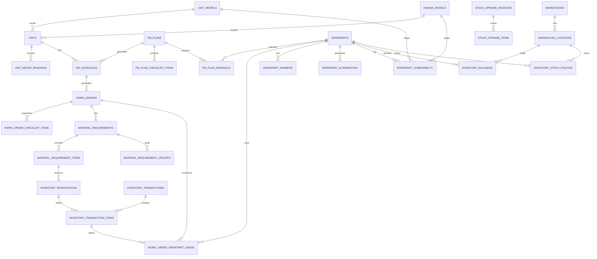

# GSI Work Order & Maintenance: PRD

**Status:** Baseline rilis/UI tahap 1 accepted — rev. 4 (v0.1.7 / M7); acceptance server UAT tetap gate terpisah.
**Author:** Azvan IT (PT GSI)
**Date:** 2026-11-18
**Last updated:** 2026-11-23
**Repo rencana:** `gsi-workorder` (mono-repo, §7)
**Baseline locked:** Milestone 0 (scaffold, schema, seed, Docker; lihat §5.2) — **locked**, tidak boleh diubah tanpa approval eksplisit.

| Rev | Tanggal | Perubahan |
|---|---|---|
| 1 | 2026-11-18 | PRD awal: P2H → usulan WO → WO |
| 2 | 2026-11-18 | Alur konfirmasi WO, toggle otomatis, audit setting |
| 3 | 2026-11-18 | Ekspansi scope: PM (HM/KM/calendar), material planning & readiness, sparepart & compatibility, internal inventory, unit history, dashboard/reporting, timezone WITA. Roadmap M1–M7 disusun ulang; M0 tetap locked. |
| 4 | 2026-11-23 | Baseline tahap 1 / `v0.1.7` (M7): rebranding UI PAMS, dashboard shadcn dengan data nyata, hero tanpa tanggal/summary, Beta badge amber, urutan menu Usulan WO, dan versi sidebar `v.0.1.7`. PRD dan Agent Brief tetap dipertahankan sebagai source of truth; masukan user dicatat di decision log, bukan dihapus. |

Dokumen pendukung:

* `docs/Agent Brief.md` — instruksi operasional untuk coding agent.
* `docs/Data Model.md` — ERD, kamus tabel, proposal DDL, dan view.
* `docs/Domain Rules.md` — status transition, aturan bisnis, RBAC.
* `docs/Timezone.md` — desain UTC/WITA dan scheduler.

---

## 1. Context (The "Why")

### 1.1 Masalah saat ini

1. **Temuan P2H tidak menjadi pekerjaan.** Temuan kerusakan sudah tercatat di P2H Odoo (4.333 laporan, 2.432 bertemuan, 238 unit), tetapi tidak ada sistem yang mengubahnya menjadi pekerjaan maintenance yang ditugaskan dan ditutup. Tindak lanjut tersebar di chat dan spreadsheet.
2. **Preventive Maintenance (PM) tidak terkontrol.** Jadwal servis berdasarkan HM, KM, kalender, atau kombinasi masih manual. Tidak ada satu sumber untuk interval per unit/model, last/next due, checklist, dan riwayat PM.
3. **Material tidak siap saat WO dimulai.** Mekanik sering menunggu sparepart. Tidak ada mekanisme untuk menghitung kebutuhan material, mengecek ketersediaan, melakukan reservasi, dan melacak shortage sebelum pekerjaan dimulai.
4. **Data sparepart tersebar dan tidak terverifikasi.** Nomor OEM, brand, part alternatif, dan kecocokan dengan unit/model/engine/configuration tidak terpusat. Risiko salah part tinggi.
5. **Stok internal tidak akurat.** Receipt, issue, return, transfer, adjustment, dan stock opname tidak tercatat dalam ledger yang konsisten. Stok fisik dan catatan berbeda.
6. **Riwayat unit terfragmentasi.** Tidak ada profil unit yang menyatukan riwayat P2H, PM, WO, pemakaian sparepart, HM/KM, downtime, mekanik, dan supervisor. Total statis sering dipakai sebagai pengganti transaksi aktual.

### 1.2 Peluang

* API P2H sudah stabil; temuan dapat menjadi **usulan WO** yang dikonfirmasi planner, bukan WO otomatis tanpa kontrol.
* PM dapat dijadwalkan dari HM/KM/calendar dengan aturan **threshold pertama yang tercapai**, lalu menghasilkan WO dan kebutuhan material.
* Inventory internal dapat menjadi sumber kebenaran ketersediaan material, sementara **Accurate tetap menjadi sistem procurement dan pembelian**.
* Unit history dapat dibangun dari transaksi aktual (WO, PM, usage, ledger), bukan dari tabel total statis.

### 1.3 Prinsip produk

1. **Actual transactions over static totals.** Semua history, konsumsi, downtime, dan interval dihitung dari transaksi aktual.
2. **No procurement in this app.** Material Order adalah perencanaan material maintenance, bukan purchasing. Accurate tetap bertanggung jawab atas approval, PO, dan transaksi procurement.
3. **No hidden stock mutation.** Semua perubahan saldo stok melalui inventory transaction yang posted. Planning dan reservation tidak mengurangi stok fisik.
4. **No duplicate source of truth.** Satu konsep = satu tabel kanonik; selebihnya view atau cache yang dapat dibangun ulang.
5. **UTC storage, WITA experience.** Server, PostgreSQL, backend, dan storage memakai UTC; input, display, dan jadwal operasional memakai WITA (`Asia/Makassar`).
6. **Human control by default.** PM auto-WO dan P2H auto-WO default `false`; aktivasi harus eksplisit, ganda, dan diaudit.

---

## 2. Job Stories (The "Who & What")

### 2.1 Baseline P2H/WO

* **Story 1:** Sebagai planner, ketika P2H menemukan komponen rusak, saya ingin menerima notifikasi berisi usulan WO (unit, komponen, prioritas), supaya saya bisa menyetujui atau menolaknya dengan sadar.
* **Story 2:** Sebagai planner, ketika saya menolak usulan WO, saya ingin menuliskan alasannya, supaya temuan tetap punya jejak keputusan.
* **Story 3:** Sebagai mekanik, ketika menerima tugas, saya ingin melihat unit, komponen rusak, dan catatan pemeriksa dalam satu layar, supaya tidak perlu membuka Odoo.
* **Story 4:** Sebagai supervisor, saya ingin melihat unit yang paling sering bermasalah dan usulan yang belum diputuskan, supaya tidak ada temuan menggantung.
* **Story 5:** Sebagai admin, ketika Odoo tidak dapat diakses, saya ingin aplikasi tetap jalan dengan data terakhir yang tersinkron.

### 2.2 Preventive Maintenance

* **Story 6:** Sebagai planner, saya ingin membuat PM plan per unit atau per model dengan interval HM, KM, dan/atau kalender, supaya servis jatuh tempo tepat waktu tanpa mengingat manual.
* **Story 7:** Sebagai planner, saya ingin melihat PM yang upcoming, due soon, dan overdue, supaya saya bisa menyiapkan WO dan material sebelum unit berhenti.
* **Story 8:** Sebagai mekanik, saya ingin checklist PM yang jelas dan dapat mencatat HM/KM saat eksekusi, supaya hasil servis konsisten dan next due dapat dihitung.

### 2.3 Material & Inventory

* **Story 9:** Sebagai planner, saya ingin sistem menghitung kebutuhan material untuk WO/PM dan menunjukkan ready, partially ready, atau shortage, supaya saya tahu apakah pekerjaan bisa dimulai.
* **Story 10:** Sebagai storekeeper, saya ingin mencatat receipt, issue, return, transfer, adjustment, dan stock opname, supaya saldo stok selalu dapat diaudit.
* **Story 11:** Sebagai storekeeper, saya ingin reservasi material tidak mengurangi stok fisik, tetapi issue benar-benar mengurangi stok, supaya alokasi dan pemakaian tidak tercampur.
* **Story 12:** Sebagai supervisor, saya ingin melihat unit yang menunggu sparepart dan umur shortage, supaya saya bisa eskalasi atau mencari alternatif.

### 2.4 Sparepart, Unit History & Reporting

* **Story 13:** Sebagai planner, saya ingin mencari sparepart berdasarkan nomor OEM, brand, alternatif, dan kecocokan unit/model/engine, supaya saya tidak salah memesan part.
* **Story 14:** Sebagai reliability engineer, saya ingin melihat riwayat komponen per unit dan interval penggantian aktual, supaya saya bisa menetapkan interval PM berbasis data.
* **Story 15:** Sebagai manajemen, saya ingin dashboard PM compliance, downtime, stock, dan material readiness, supaya keputusan operasional berbasis data aktual.

---

## 3. Functional Requirements

### 3.1 Baseline requirements R1–R17 (delivery M0–M7)

> **Status implementasi:** M0 hanya scaffold, 15 tabel, seed, Docker, dan healthcheck (lihat README status milestone). R1–R16 adalah requirement baseline yang dieksekusi bertahap sesuai roadmap M1–M7; R17 (Docker) adalah bagian M0 dan masih menunggu verifikasi runtime Linux. Checkbox di bawah adalah status requirement, bukan klaim bahwa route/auth/P2H sudah ada. Jangan mengubah migrasi/kode M0.

* [ ] **R1 — Autentikasi via Odoo, sesi lokal.** Login memakai kredensial Odoo yang divalidasi ke `POST /api/auth/login`; aplikasi menerbitkan JWT sendiri (access 12 jam, refresh 7 hari).
* [ ] **R2 — Sinkron user & employee.** Worker menarik user/employee dari Odoo setiap 6 jam ke `users`/`employees`; user nonaktif dinonaktifkan lokal, tidak dihapus.
* [ ] **R3 — Sinkron P2H periodik.** Worker menarik daftar P2H setiap 15 menit, lalu detail checklist untuk laporan baru/berubah; idempoten per `odoo_report_id`.
* [ ] **R4 — Ekstraksi temuan.** Baris `rusak`/`tidak_ada` disimpan di `p2h_findings`; baris `baik` tidak disimpan, jumlah item diperiksa dicatat.
* [ ] **R5 — Usulan WO dari P2H, bukan WO otomatis.** Satu laporan bertemuan menghasilkan satu `wo_candidates` unik; worker tidak membuat `work_orders` pada kondisi default.
* [ ] **R6 — Konfirmasi setujui/tolak.** Planner/admin menyetujui → WO dibuat; menolak → `skipped` dengan alasan wajib; bulk maksimal 50.
* [ ] **R7 — Toggle otomatis P2H.** `p2h_auto_wo` default `false`; hanya usulan baru yang terpengaruh; perubahan dicatat di `app_settings_history`.
* [ ] **R8 — Notifikasi.** Notifikasi in-app untuk planner/admin, keputusan usulan, dan reminder 24 jam; email opsional fase berikut.
* [ ] **R9 — WO manual.** Planner dapat membuat WO tanpa usulan P2H.
* [ ] **R10 — Siklus hidup WO baseline.** `open → in_progress ↔ waiting_part → done`, plus `cancelled`; waiting_part kembali ke in_progress; perubahan tercatat di `wo_updates`.
* [ ] **R11 — Penugasan & lampiran.** Satu assignee; foto jpg/png maks 5 MB di volume lokal.
* [ ] **R12 — Dashboard baseline.** WO per status, usulan pending, prioritas tinggi, temuan 30 hari, top komponen, ranking unit, aging.
* [ ] **R13 — Halaman unit baseline.** Riwayat P2H, temuan terakhir, usulan & WO, HM/KM terakhir.
* [ ] **R14 — Kemandirian.** Semua endpoint baca hanya query PostgreSQL; Odoo hanya diakses worker.
* [ ] **R15 — Observability sinkron.** `sync_runs`, tombol sinkron, `/healthz`, `/metrics`.
* [ ] **R16 — Role baseline.** `admin`, `planner`, `mechanic`, `viewer`; otorisasi dicek di server.
* [ ] **R17 — Docker sekali jalan.** Empat service: `web`, `api`, `worker`, `db`; migrasi otomatis; volume persisten.

### 3.2 Preventive Maintenance (PM)

* [ ] **PM-01 — Plan per unit atau per model.** PM plan dapat ditargetkan ke satu unit **atau** satu unit model (exactly one), dengan effective date dan status `draft|active|inactive`.
* [ ] **PM-02 — Interval fleksibel.** Setiap plan dapat memiliki `interval_hm`, `interval_km`, dan/atau `interval_days`; minimal satu interval wajib diisi. Tidak ada interval servis yang di-hardcode di kode.
* [ ] **PM-03 — Combined interval.** Bila lebih dari satu interval diisi, default memakai **threshold pertama yang tercapai** (`first_reached`). Plan dapat memilih `all_required` bila kebijakan servis mensyaratkan semua threshold.
* [ ] **PM-04 — Last/next due.** Sistem menyimpan last completed HM/KM/date dan menghitung next due HM/KM/date. Planner dapat melakukan override next due dengan alasan yang tercatat.
* [ ] **PM-05 — Upcoming, due soon, overdue.** Notifikasi dan daftar PM untuk status upcoming (default 30 hari), due soon (default 7 hari), dan overdue. Untuk plan HM/KM, ambang upcoming/due soon dapat diisi absolute HM/KM; jika kosong, hanya due/overdue yang dinotifikasi. Ambang hari dapat di-override per plan.
* [ ] **PM-06 — Checklist PM.** Plan memiliki checklist item berurutan (komponen, task, standard); hasil eksekusi disimpan sebagai snapshot pada WO, bukan hanya pada template.
* [ ] **PM-07 — PM menghasilkan WO.** PM due dapat menghasilkan WO `source='pm'`, `maintenance_type='preventive'`, dengan snapshot checklist; material plan disalin menjadi material requirement saat modul material aktif (M6). Auto-WO hanya aktif bila **global setting dan plan flag** sama-sama `true`.
* [ ] **PM-08 — Material requirement dari plan.** Material yang didefinisikan pada plan disimpan sebagai template `pm_plan_materials` (M5); setelah modul material aktif (M6), template disalin menjadi `material_requirements` saat WO dibuat dan belum dilakukan stock check otomatis.
* [ ] **PM-09 — Penyelesaian PM.** WO PM tidak dapat `done` tanpa reading yang diwajibkan plan (HM/KM/date); penyelesaian memperbarui schedule, meter reading, dan membuat siklus berikutnya bila plan masih aktif/effective.
* [ ] **PM-10 — PM history.** Riwayat PM dibaca dari WO PM yang selesai (tanggal, HM/KM, mekanik, supervisor, checklist, material usage, downtime), bukan tabel history terpisah.
* [ ] **PM-11 — PM compliance.** Sistem menghitung due vs completed on time, overdue, dan completion rate per plan/unit/model/periode.
* [ ] **PM-12 — Guardrail auto-WO.** Default `pm_auto_wo=false` dan `auto_generate_wo=false`. Hanya admin yang boleh mengubah global setting; setiap perubahan masuk `app_settings_history`. P2H tetap memakai mekanisme candidate dan tidak boleh memakai PM auto-WO.

### 3.3 Sparepart & Compatibility

* [ ] **SP-01 — Master sparepart.** Kode internal unik, nama, kategori, UOM, deskripsi, status aktif. Tidak menyimpan harga, cost, vendor price, atau data procurement.
* [ ] **SP-02 — Nomor OEM/aftermarket & brand.** Satu sparepart dapat memiliki banyak nomor part (OEM, aftermarket, superseded) dengan brand dan primary flag.
* [ ] **SP-03 — Alternatif & cross-reference.** Hubungan equivalent/superseded/substitute antar sparepart, dengan status verifikasi dan catatan.
* [ ] **SP-04 — Compatibility.** Pemetaan sparepart ke unit model, engine model, dan/atau configuration (mis. 4x4, standard cab). Minimal satu target harus diisi.
* [ ] **SP-05 — Status verifikasi.** `Pending Verification`, `Approved Compatible`, `Conditional Compatible`, `Not Compatible`; conditional wajib memiliki catatan kondisi. Verifikator dan waktu dicatat.
* [ ] **SP-06 — Pencarian.** Cari berdasarkan kode internal, nama, nomor OEM/aftermarket, brand, unit model, engine model, dan status compatibility.
* [ ] **SP-07 — Tidak menghapus master yang sudah dipakai.** Sparepart yang direferensikan transaksi hanya dapat dinonaktifkan (`is_active=false`), tidak dihapus.
* [ ] **SP-08 — Audit perubahan.** Perubahan status compatibility dan data kritis harus dapat ditelusuri (minimal `updated_at`, `verified_by`, `verified_at`; history table ditambahkan bila audit penuh dibutuhkan).

### 3.4 Internal Inventory

* [ ] **INV-01 — Warehouse & location.** Master gudang dan lokasi (rack/bin/yard/staging) dengan kode unik per gudang.
* [ ] **INV-02 — Receipt.** Penerimaan barang menambah `on_hand` pada lokasi tujuan; referensi dokumen eksternal (mis. nomor Accurate) dicatat sebagai teks, bukan transaksi procurement.
* [ ] **INV-03 — Issue.** Pengeluaran barang mengurangi `on_hand`; issue untuk WO harus tertaut ke WO/material requirement, issue manual wajib beralasan.
* [ ] **INV-04 — Reservation & release.** Reservasi menambah `reserved`, tidak mengurangi `on_hand`; release mengurangi `reserved`. Reservasi tidak boleh melebihi available stock.
* [ ] **INV-05 — Transfer.** Perpindahan antar lokasi mengurangi `on_hand` asal dan menambah `on_hand` tujuan dalam satu transaksi.
* [ ] **INV-06 — Adjustment.** Koreksi saldo dengan alasan wajib dan approver; bukan edit langsung `inventory_balances`.
* [ ] **INV-07 — Stock opname.** Session counting → review → posting; perbedaan menghasilkan transaction adjustment/opname, bukan update saldo langsung.
* [ ] **INV-08 — Immutable ledger.** `inventory_transactions` dan item yang sudah `posted` tidak boleh dihapus atau diubah qty/item-nya; satu-satunya update status adalah `posted → reversed` saat reversal. Koreksi memakai reversal/adjustment dengan `reversal_of_id`.
* [ ] **INV-09 — Balance cache.** `inventory_balances` adalah cache yang diperbarui dalam transaksi DB yang sama; dapat dibangun ulang dari ledger.
* [ ] **INV-10 — Minimum stock.** Policy min/critical per sparepart per lokasi; alert low/critical stock dihitung dari available (`on_hand - reserved`).
* [ ] **INV-11 — Movement history.** Semua receipt, issue, return, transfer, reserve, release, adjustment, dan opname dapat dilihat per sparepart/lokasi/periode.
* [ ] **INV-12 — No negative stock.** `on_hand` dan `reserved` tidak boleh negatif; issue divalidasi terhadap available + reservasi yang dialokasikan, sedangkan transfer/reserve terhadap available.
* [ ] **INV-13 — Reversal.** Reversal membuat transaction baru dengan arah berlawanan, menautkan transaksi asal, dan menandai asal `reversed`; tidak menghapus baris.
* [ ] **INV-14 — Single write path.** Semua perubahan saldo wajib melalui inventory transaction yang posted; tidak ada endpoint yang meng-update saldo langsung.

### 3.5 Material Planning & Readiness

* [ ] **MAT-01 — Material requirement per WO.** Satu WO memiliki maksimal satu material requirement non-`cancelled` (partial unique index pada `wo_id` untuk status non-`cancelled`), berisi item sparepart dan qty required.
* [ ] **MAT-02 — Lifecycle.** Status: `Draft`, `Planned`, `Checking Stock`, `Ready`, `Partially Ready`, `Shortage`, `Reserved`, `Issued`, `Completed`, `Cancelled`.
* [ ] **MAT-03 — Planning tidak mengurangi stok.** Membuat/mengubah material requirement, termasuk status `Planned` dan `Checking Stock`, tidak mengubah `on_hand` maupun `reserved`.
* [ ] **MAT-04 — Reservation tidak mengurangi stok fisik.** Reservasi hanya menambah `reserved`; `on_hand` tetap.
* [ ] **MAT-05 — Issue & return.** Issue mengurangi `on_hand` dan mencatat actual usage; return menambah `on_hand` dan mencatat usage return. Keduanya melalui inventory transaction.
* [ ] **MAT-06 — Readiness & shortage.** Sistem menghitung required, reserved, issued, returned, coverage, dan shortage per item; item `is_optional` tidak memblokir readiness; status header mengikuti aturan prioritas di `docs/Domain Rules.md`.
* [ ] **MAT-07 — Waiting part.** WO dapat berpindah ke `waiting_part` bila material requirement `Shortage`/`Partially Ready`; kembali ke `in_progress` bila ready/reserved. Durasi waiting dihitung dari `wo_updates`.
* [ ] **MAT-08 — Shortage aging.** Umur shortage dihitung sejak status `Shortage` pertama kali aktif; dashboard menampilkan aging.
* [ ] **MAT-09 — Bukan procurement.** Tidak ada PR, PO, vendor selection, approval pembelian, harga, atau posting ke Accurate. Accurate tetap sistem procurement.
* [ ] **MAT-10 — PM integration.** Setelah modul material aktif (M6), material plan PM disalin ke material requirement WO; perubahan plan setelah WO dibuat tidak mengubah snapshot WO.
* [ ] **MAT-11 — Cancellation.** WO/material requirement yang dibatalkan melepas semua reservasi aktif; issue yang sudah posted tidak dihapus, tetapi dapat direturn/direversal sesuai aturan.
* [ ] **MAT-12 — Partial fulfillment.** Issue parsial diperbolehkan; status `Issued` menandakan issue sudah dimulai dan tidak ada shortage, sedangkan `Completed` hanya setelah WO selesai dan reservasi aktif habis/dilepas.

### 3.6 Unit Maintenance History

* [ ] **UH-01 — Profil unit terpusat.** Satu halaman unit menampilkan identitas, model/engine, HM/KM terkini, status breakdown, ringkasan biaya? **Tidak** — biaya di luar scope; ringkasan aktivitas dan material.
* [ ] **UH-02 — Maintenance timeline.** Semua WO (P2H, manual, PM) tampil kronologis dengan tipe, status, tanggal, mekanik, supervisor, temuan, dan material.
* [ ] **UH-03 — Sparepart/component history.** Pemakaian sparepart per unit/komponen dari `work_order_sparepart_usage`, termasuk qty, tanggal, WO, lokasi, dan HM/KM saat pemakaian.
* [ ] **UH-04 — Actual usage only.** History tidak boleh dihitung dari material requirement yang belum di-issue, static total, atau angka manual.
* [ ] **UH-05 — HM/KM history.** Reading HM/KM dari P2H, WO, dan input manual tersimpan di `unit_meter_readings`; `units.current_hm/current_km` adalah cache.
* [ ] **UH-06 — Downtime.** Downtime WO `done` dihitung dari `started_at` (fallback `created_at` untuk breakdown/corrective) sampai `closed_at`, dipisah planned (preventive) vs unplanned (breakdown/corrective), termasuk durasi `waiting_part`; cancelled tidak dihitung.
* [ ] **UH-07 — Mekanik & supervisor.** Setiap WO menyimpan assignee (mekanik) dan supervisor; history menampilkan keduanya.
* [ ] **UH-08 — Component replacement interval.** Interval penggantian per unit/komponen dihitung dari jarak waktu atau HM/KM antar actual replacement; bukan dari interval plan.
* [ ] **UH-09 — No static totals.** Total biaya, total downtime, dan total pemakaian di dashboard adalah agregasi query, bukan kolom total yang di-update manual.

### 3.7 Dashboard & Reporting

* [ ] **DASH-01 — PM due/overdue.** Jumlah dan daftar PM upcoming, due soon, overdue per unit/model/plan.
* [ ] **DASH-02 — Material readiness/shortage.** WO dengan material ready, partially ready, shortage; item shortage dan qty.
* [ ] **DASH-03 — Waiting-part units.** Unit yang sedang menunggu sparepart, durasi, dan WO terkait.
* [ ] **DASH-04 — Low/critical stock.** Sparepart di bawah min/critical per lokasi, dengan available dan on-hand.
* [ ] **DASH-05 — Maintenance activity.** WO per tipe/status/periode, completion, dan backlog.
* [ ] **DASH-06 — Breakdown/downtime.** Unit breakdown, downtime hours, MTTR sederhana, tren per periode.
* [ ] **DASH-07 — PM compliance.** Due vs completed on time, overdue rate, compliance per plan/unit/model.
* [ ] **DASH-08 — Shortage aging.** Umur shortage per WO/item, bucket 0–3/4–7/8–14/>14 hari.
* [ ] **DASH-09 — Sparepart consumption.** Qty pemakaian per sparepart/unit/periode; tanpa nilai rupiah.
* [ ] **DASH-10 — Inventory movement.** Receipt, issue, return, transfer, adjustment, opname per periode/lokasi.
* [ ] **DASH-11 — Component replacement frequency.** Frekuensi dan interval penggantian per unit/komponen.
* [ ] **DASH-12 — Filter, export, timezone.** Filter unit/model/location/period; export CSV untuk tabel; semua bucket harian/mingguan/bulanan memakai batas WITA.

### 3.8 Timezone (WITA)

* [ ] **TZ-01 — UTC storage.** Server OS, PostgreSQL, backend, dan storage memakai UTC. Semua event timestamp memakai `TIMESTAMPTZ`.
* [ ] **TZ-02 — WITA display/input.** Semua input dan display waktu bisnis memakai WITA (`Asia/Makassar`), bukan `Asia/Jakarta`.
* [ ] **TZ-03 — Config.** `APP_TIMEZONE=Asia/Makassar`; proses container memakai `TZ=UTC`; PostgreSQL session `timezone=UTC`. Aplikasi gagal fast bila timezone tidak valid.
* [ ] **TZ-04 — Tipe data.** Event/audit/scheduler memakai `TIMESTAMPTZ`; tanggal bisnis (report date, due date, effective date, opname date) memakai `DATE`.
* [ ] **TZ-05 — Scheduler.** Job 07:00 WITA harus dieksekusi pada 23:00 UTC hari sebelumnya; scheduler menghitung di WITA lalu dikonversi ke UTC.
* [ ] **TZ-06 — No hardcoded offset.** Dilarang `+8`, `time.FixedZone`, atau penjumlahan jam manual. Gunakan IANA `Asia/Makassar`.
* [ ] **TZ-07 — Reporting boundaries.** Hari/minggu/bulan untuk laporan dihitung pada batas WITA, lalu dikonversi ke rentang UTC untuk query.
* [ ] **TZ-08 — Serialization.** API mengembalikan ISO 8601 dengan offset/UTC; web memformat dengan `Intl.DateTimeFormat` dan `timeZone: 'Asia/Makassar'`.

### 3.9 Cross-cutting

* [ ] **X-01 — RBAC.** Role baseline `admin|planner|mechanic|viewer` ditambah `storekeeper`; matrix lengkap di `docs/Domain Rules.md`.
* [ ] **X-02 — Audit.** Perubahan setting, approval, status WO, transaksi inventory, dan verifikasi compatibility mencatat pelaku dan waktu.
* [ ] **X-03 — Idempotency.** Sync P2H, PM auto-WO, dan posting inventory harus idempoten terhadap retry.
* [ ] **X-04 — Performance.** List & dashboard p95 <500 ms pada volume baseline; history unit memakai index dan view yang tepat.
* [ ] **X-05 — Data integrity.** FK, unique constraint, check constraint, dan transaksi DB untuk operasi multi-tabel.
* [ ] **X-06 — No new service.** Tetap 4 service; tidak ada Redis, message broker, atau search engine.

---

## 4. Tech Stack

| Layer | Pilihan | Catatan |
|---|---|---|
| Frontend | **Next.js 15 (App Router) + TypeScript** | SSR untuk daftar, CSR untuk drawer/form |
| UI | **Tailwind CSS + shadcn/ui** | komponen copy-in; `Sheet`, `Dialog`, `Table`, `Toast`, `Switch` |
| FE data | **TanStack Query** + React Hook Form + Zod | cache, retry, validasi |
| Backend | **Go 1.22+ + Gin** | REST JSON, middleware JWT + RBAC |
| DB access | **pgx/v5 + sqlc** | query type-safe tanpa ORM; migrasi `golang-migrate` |
| Database | **PostgreSQL 16** | satu instance, schema `public`; `timezone=UTC` |
| Job sinkron | goroutine + `robfig/cron` di container `worker` | `SYNC_INTERVAL` (default 15m); cron location `Asia/Makassar` |
| Notifikasi | tabel `notifications` + polling/SSE di web | email opsional via SMTP |
| Auth | Odoo `/api/auth/login` → **JWT lokal** (`golang-jwt`) | password user tidak disimpan |
| File | volume lokal `/data/uploads` | foto WO, path di DB |
| Reporting | SQL view + query agregasi | export CSV; tidak ada BI service |
| Observability | `log/slog` JSON + `/metrics` (prometheus client) | log sinkron memuat counter usulan & WO |
| Deploy | **Docker Compose** di server PT GSI | tanpa Kubernetes |
| Proxy | Caddy/Nginx opsional | TLS internal |

**Aturan stack:** tidak pakai ORM berat (Prisma/GORM), tidak ada DB selain Postgres, tidak ada Redis/message broker di fase 1. Reporting memakai view/query, bukan service baru. Timezone memakai IANA database, bukan offset tetap.

---

## 5. Data Model (PostgreSQL)

### 5.1 Prinsip

1. **Satu tabel kanonik per konsep.** Tabel history, usage, dan adjustment tidak diduplikasi bila dapat menjadi view atau tipe transaksi.
2. **Ledger immutable.** `inventory_transactions` + items adalah sumber kebenaran saldo; `inventory_balances` hanya cache.
3. **Snapshot pada WO.** Checklist PM disalin saat WO dibuat; material plan disalin menjadi material requirement saat modul material aktif (M6), agar perubahan template tidak mengubah history.
4. **Master + transaksi.** Master unit/sparepart/inventory/PM terpisah dari transaksi; tidak ada field denormalized yang menjadi sumber kebenaran kedua.
5. **UTC + DATE.** Timestamp memakai `TIMESTAMPTZ`; tanggal bisnis memakai `DATE`.
6. **Proposal, bukan migrasi.** Tabel M1+ di dokumen ini adalah proposal; implementasi harus melalui migration baru dan approval milestone.

### 5.2 Tabel M0 — implemented & locked (15 tabel aplikasi)

| Tabel | Fungsi |
|---|---|
| `users` | akun login; `odoo_user_id` unik; role baseline 4 nilai |
| `employees` | karyawan Odoo; `odoo_employee_id` unik |
| `units` | master unit; `odoo_unit_id` unik; `code` = no lambung |
| `p2h_reports` | snapshot laporan P2H; `odoo_report_id` unik; `raw jsonb` |
| `p2h_findings` | temuan checklist; `odoo_line_id` unik; condition rusak/tidak_ada |
| `wo_candidates` | usulan WO P2H; `p2h_report_id` unik; status pending/approved/skipped/auto_created/archived; `notified_at` |
| `work_orders` | WO dari P2H/manual; `code` unik; `p2h_report_id` unik |
| `wo_findings` | relasi WO ↔ temuan P2H; PK gabungan |
| `wo_updates` | riwayat status/komentar WO; append-only |
| `wo_attachments` | lampiran WO; path file lokal |
| `notifications` | notifikasi in-app; `ref_type`/`ref_id` |
| `app_settings` | setting aplikasi; seed `p2h_auto_wo=false`, `candidate_sla_hours=24`, `candidate_backfill_days=30` |
| `app_settings_history` | audit perubahan setting |
| `sync_runs` | log eksekusi sinkron |
| `sync_state` | cursor & metadata sinkron |

Catatan M0:

* Total aplikasi = **15 tabel**; `schema_migrations` adalah tabel migrasi, bukan tabel aplikasi.
* Constraint `work_orders.source` saat ini hanya `p2h|manual`; constraint `work_orders.status` sudah memiliki `waiting_part` dan **harus dipakai ulang** untuk material waiting.
* `units` belum memiliki model/engine/configuration; perluasan dilakukan di M1.
* M0 tidak memiliki tabel PM, sparepart, inventory, atau material. Semua tabel di §5.3–§5.8 adalah **proposal M1+**.

### 5.3 Master baru

| Tabel | Fungsi | Kunci / aturan |
|---|---|---|
| `unit_models` | model unit | unique `(manufacturer, model)`; `category`; `is_active` |
| `engine_models` | model engine | unique `(manufacturer, model)`; `fuel_type`; `displacement_cc` |
| `components` | komponen/assembly untuk checklist & history | `code` unik; `name`; `category`; `is_active` |
| `unit_meter_readings` | riwayat HM/KM aktual | `unit_id`, `reading_type hm/km`, `value`, `recorded_at`, `source_type/source_id`; unique per source |
| `spareparts` | master sparepart | `code` unik; `uom`; `is_active`; tanpa harga/cost |
| `sparepart_numbers` | nomor OEM/aftermarket/superseded | `sparepart_id`; `part_number`; `brand`; `number_type`; `is_primary` |
| `sparepart_alternatives` | cross-reference antar sparepart | `relation_type equivalent/superseded/substitute`; status verifikasi |
| `sparepart_compatibility` | kecocokan sparepart ke unit/engine/config | minimal satu target; status verifikasi; `verified_by/at` |
| `warehouses` | master gudang | `code` unik; `site_location` |
| `warehouse_locations` | lokasi di gudang | unique `(warehouse_id, code)`; `location_type` |
| `inventory_stock_policies` | min/critical/reorder per sparepart per lokasi | unique `(sparepart_id, warehouse_location_id)` |

Perluasan `units` (bukan tabel baru): `unit_model_id`, `engine_model_id`, `serial_number`, `engine_serial_number`, `current_hm`, `current_km`, `hm_updated_at`, `km_updated_at`, `is_active`. Field lama `merk`, `unit_type`, `class_unit` dipertahankan untuk kompatibilitas dan di-backfill bertahap.

### 5.4 Preventive Maintenance

| Tabel | Fungsi | Kunci / aturan |
|---|---|---|
| `pm_plans` | definisi PM per unit atau per model | exactly one of `unit_id`/`unit_model_id`; minimal satu interval > 0; `interval_rule first_reached/all_required`; ambang notifikasi hari/HM/KM; `auto_generate_wo=false`; `status draft/active/inactive` |
| `pm_plan_checklist_items` | template checklist PM | `pm_plan_id`; `sequence`; `component_id`; `task`; `standard` |
| `pm_plan_materials` | material yang dibutuhkan plan | `pm_plan_id`; `sparepart_id`; `qty`; `is_optional` |
| `pm_schedules` | siklus due per plan+unit | unique active `(pm_plan_id, unit_id)`; `cycle_no`; `due_hm/km/date`; `last_*`; `status scheduled/due/overdue/wo_created/completed/skipped/cancelled`; override/skip/cancel reason terstruktur |

Perluasan `work_orders` (bukan tabel baru): `source` ditambah `pm`; `maintenance_type preventive/corrective/breakdown/inspection`; `pm_schedule_id` nullable dengan partial unique index untuk WO non-`cancelled`; `supervisor_id`; `started_at`; `closed_at` sudah ada.

### 5.5 Work order & checklist

| Tabel | Fungsi | Kunci / aturan |
|---|---|---|
| `work_order_checklist_items` | snapshot checklist PM pada WO | `wo_id`; `pm_plan_checklist_item_id` nullable; `sequence`; `component_id`; `task`; `standard`; `result pending/ok/not_ok/na`; `checked_by/at` |

### 5.6 Material planning

| Tabel | Fungsi | Kunci / aturan |
|---|---|---|
| `material_requirements` | header kebutuhan material per WO | partial unique non-`cancelled` pada `wo_id`; status 10 nilai; `source pm/manual`; `requested_by/at`; `status_changed_at`; `shortage_since` |
| `material_requirement_items` | item kebutuhan | unique `(material_requirement_id, sparepart_id)`; `qty_required`; `qty_reserved`; `qty_issued`; `qty_returned`; `is_optional`; `preferred_warehouse_id` |
| `material_requirement_updates` | audit status material | `material_requirement_id`; `status_from/to`; `user_id`; `note`; append-only |

Shortage tidak disimpan sebagai kolom kanonik; dihitung di view/query: `GREATEST(qty_required - (available + qty_reserved + (qty_issued - qty_returned)), 0)`. Item `is_optional` tidak dihitung sebagai penghalang readiness.

### 5.7 Inventory

| Tabel | Fungsi | Kunci / aturan |
|---|---|---|
| `inventory_transactions` | header ledger | `code` unik; type `receipt/issue/return/reserve/release/transfer/adjustment/opname`; status `posted/reversed`; `reversal_of_id`; `idempotency_key` unik opsional; `posted_by/at` |
| `inventory_transaction_items` | baris ledger | `transaction_id`; `sparepart_id`; `from_location_id`/`to_location_id`; `qty > 0`; `reservation_id` nullable |
| `inventory_balances` | cache saldo per sparepart+lokasi | PK `(sparepart_id, warehouse_location_id)`; `on_hand`, `reserved`; check non-negatif dan `reserved <= on_hand` |
| `inventory_reservations` | state reservasi | `material_requirement_item_id`; `sparepart_id`; `warehouse_location_id`; `qty` remaining; status `active/consumed/released/cancelled` |
| `stock_opname_sessions` | session opname | `code` unik; warehouse; status `draft/counting/review/posted/cancelled` |
| `stock_opname_items` | baris hitung | `session_id`; `sparepart_id`; `location_id`; `system_qty`; `counted_qty`; `difference` |

Aturan arah ledger:

* receipt/return/adjustment increase/opname increase → `to_location_id`.
* issue/adjustment decrease/opname decrease → `from_location_id`.
* transfer → both `from_location_id` dan `to_location_id`.
* reserve/release → `from_location_id` sebagai lokasi yang di-reserve; `on_hand` tidak berubah.

### 5.8 Actual usage & history

| Tabel | Fungsi | Kunci / aturan |
|---|---|---|
| `work_order_sparepart_usage` | pemakaian aktual per WO | `wo_id`; `material_requirement_item_id` nullable; `sparepart_id`; `component_id` nullable; `warehouse_location_id`; `qty`; `hm/km` snapshot; `movement_type issue/return`; `inventory_transaction_item_id`; `return_of_usage_id` nullable; `used_by/at` |

Tabel ini **bukan** ledger; ia adalah penghubung antara actual usage dan ledger. Saldo tetap hanya berubah melalui `inventory_transactions`.

### 5.9 View kanonik (bukan tabel baru)

| View | Fungsi |
|---|---|
| `v_pm_due` | PM schedule + status due/overdue + sisa hari/HM/KM |
| `v_pm_compliance` | due vs completed on time per plan/unit/periode |
| `v_material_readiness` | required/reserved/issued/returned/coverage/shortage per item |
| `v_stock_balance` | on_hand, reserved, available, min/critical status |
| `v_unit_maintenance_history` | timeline WO per unit (P2H/manual/PM) |
| `v_unit_component_history` | actual usage per unit/komponen/sparepart |
| `v_unit_downtime` | downtime dan waiting-part duration per WO/unit |
| `v_shortage_aging` | umur shortage per WO/item |
| `v_sparepart_consumption` | konsumsi per sparepart/unit/periode |
| `v_inventory_movement` | ledger movement per sparepart/lokasi/periode |
| `v_component_replacement_frequency` | frekuensi & interval penggantian per unit/komponen |
| `v_low_stock` | sparepart di bawah min/critical |

### 5.10 Tabel yang sengaja TIDAK dibuat

| Kandidat | Alasan | Pengganti |
|---|---|---|
| `unit_maintenance_history` (base table) | duplikasi WO/PM/usage; rawan stale | `v_unit_maintenance_history` |
| `material_usage` | duplikasi `work_order_sparepart_usage` | `work_order_sparepart_usage` |
| `inventory_adjustments` | adjustment adalah tipe transaksi, bukan tabel terpisah | `inventory_transactions.type='adjustment'` |
| `pm_notifications` | `notifications` sudah generik | `notifications` + `ref_type/ref_id` + dedupe key |
| `waiting_material` status | `work_orders.status` sudah punya `waiting_part` | reuse `waiting_part` |
| `pm_executions` | eksekusi PM = WO; history dari WO | `work_orders` + `work_order_checklist_items` |
| `unit_downtime_events` | downtime dapat dihitung dari WO + `wo_updates` | `v_unit_downtime` |
| `stock_balances_history` | ledger sudah menyimpan history | `inventory_transaction_items` |

### 5.11 ERD konseptual



Catatan: `WORK_ORDERS` juga berelasi ke `UNITS`, `USERS`, `P2H_REPORTS`, dan `WO_CANDIDATES` dari M0; relasi baseline tidak diulang di diagram agar fokus pada modul baru.

### 5.12 Kepemilikan data

| Domain | Sumber kebenaran | Cache/derived |
|---|---|---|
| P2H | `p2h_reports`, `p2h_findings` (snapshot Odoo) | dashboard aggregates |
| WO | `work_orders`, `wo_updates`, `wo_findings`, `wo_attachments` | `v_unit_maintenance_history` |
| PM | `pm_plans`, `pm_schedules`, `pm_plan_checklist_items` | `v_pm_due`, `v_pm_compliance` |
| Checklist hasil | `work_order_checklist_items` | PM history |
| Material | `material_requirements`, `material_requirement_items`, `material_requirement_updates` | `v_material_readiness` |
| Stock | `inventory_transactions` + items | `inventory_balances`, `v_stock_balance` |
| Reservation | `inventory_reservations` | available stock |
| Usage | `work_order_sparepart_usage` | `v_unit_component_history`, consumption |
| HM/KM | `unit_meter_readings` | `units.current_hm/current_km` |
| Unit history | WO + usage + ledger + readings | views |

---

## 6. API Aplikasi (Go Gin)

> Endpoint di §6.1 adalah baseline requirements R1–R17; implementasinya tersebar di M1–M7 (hanya `/healthz` yang sudah ada di scaffold M0). Endpoint §6.2–§6.8 adalah proposal M1+; belum diimplementasikan.

### 6.1 Baseline API (R1–R17)

| Method | Path | Keterangan |
|---|---|---|
| POST | `/api/auth/login` | `{nik, password}` → `{access_token, user}` |
| POST | `/api/auth/refresh` · GET `/api/me` | sesi & profil |
| GET | `/api/wo-candidates` | filter `status`, `unit_type`, `q`; default `pending` |
| GET | `/api/wo-candidates/:id` | detail usulan + temuan + riwayat keputusan |
| POST | `/api/wo-candidates/:id/approve` | `{priority?, assignee_id?, note?}` → buat WO |
| POST | `/api/wo-candidates/:id/skip` | `{reason}` wajib ≥5 karakter |
| POST | `/api/wo-candidates/bulk` | `{ids[], action, reason?}` maks 50 |
| GET/PATCH | `/api/settings` | setting + history (admin) |
| GET | `/api/notifications` · POST `/api/notifications/read` | list & tandai dibaca |
| GET/POST | `/api/workorders` | list & buat WO manual |
| GET/PATCH | `/api/workorders/:id` · POST `:id/updates` · POST `:id/attachments` | detail, transisi, riwayat, lampiran |
| GET | `/api/units`, `/api/units/:id` | master + riwayat baseline |
| GET | `/api/p2h/reports`, `/api/p2h/reports/:id` | snapshot P2H |
| GET | `/api/dashboard/summary` | KPI baseline |
| POST | `/api/admin/sync` · GET `/api/admin/sync/runs` | kontrol sinkron |
| GET | `/healthz`, `/metrics` | health & metrik |

Format: list → `{data:[…], meta:{page,limit,total}}`; error → `{error:{code,message,fields}}` (HTTP 400/401/403/404/409/422).

Catatan: `nik` pada login aplikasi dipetakan ke field `login` Odoo (A1); aplikasi tetap menerbitkan JWT sendiri.

### 6.2 PM

| Method | Path | Keterangan |
|---|---|---|
| GET/POST | `/api/pm/plans` | list & create plan (planner/admin) |
| GET/PATCH | `/api/pm/plans/:id` | detail & update; aktivasi/deaktivasi |
| GET/POST | `/api/pm/plans/:id/checklist-items` | template checklist |
| GET/POST | `/api/pm/plans/:id/materials` | material plan (M5) |
| GET | `/api/pm/schedules` | filter status, unit, model, due window |
| GET | `/api/pm/schedules/:id` | detail + WO terkait |
| POST | `/api/pm/schedules/:id/generate-wo` | buat WO manual dari PM due |
| POST | `/api/pm/schedules/:id/override-due` | override next due + reason |
| POST | `/api/pm/schedules/:id/skip` | skip siklus + reason |
| POST | `/api/pm/schedules/:id/cancel` | cancel siklus + reason |
| GET | `/api/pm/due` | upcoming/due soon/overdue |
| GET | `/api/pm/compliance` | PM compliance report |

### 6.3 Sparepart

| Method | Path | Keterangan |
|---|---|---|
| GET/POST | `/api/spareparts` | list & create |
| GET/PATCH | `/api/spareparts/:id` | detail, update, activate/deactivate |
| GET/POST | `/api/spareparts/:id/numbers` | OEM/aftermarket numbers |
| GET/POST | `/api/spareparts/:id/alternatives` | cross-reference |
| GET/POST | `/api/spareparts/:id/compatibility` | compatibility + status verifikasi |
| POST | `/api/spareparts/:id/compatibility/:compatId/verify` | approve/conditional/not compatible |
| GET | `/api/spareparts/search` | cari nomor OEM, brand, unit model, engine |

### 6.4 Inventory

| Method | Path | Keterangan |
|---|---|---|
| GET/POST | `/api/warehouses` · `/api/warehouses/:id/locations` | master gudang/lokasi |
| GET/POST | `/api/inventory/receipts` | receipt |
| GET/POST | `/api/inventory/issues` | issue |
| GET/POST | `/api/inventory/returns` | return |
| GET/POST | `/api/inventory/transfers` | transfer |
| GET/POST | `/api/inventory/adjustments` | adjustment + reason/approver |
| GET/POST | `/api/inventory/reservations` · POST `:id/release` | reservation & release (M6) |
| POST | `/api/inventory/transactions/:id/reverse` | reversal dengan alasan; original `posted → reversed` |
| GET/POST | `/api/inventory/opname/sessions` · POST `:id/post` | stock opname |
| GET | `/api/inventory/balances` | saldo + available |
| GET | `/api/inventory/movements` | movement history |
| GET/POST | `/api/inventory/stock-policies` | min/critical policy |

### 6.5 Material (M6)

| Method | Path | Keterangan |
|---|---|---|
| GET/POST | `/api/material-requirements` | list & create per WO |
| GET/PATCH | `/api/material-requirements/:id` | detail & update (draft/planned) |
| GET | `/api/material-requirements/:id/updates` | audit status material |
| POST | `/api/material-requirements/:id/check-stock` | hitung readiness |
| POST | `/api/material-requirements/:id/reserve` | reservasi |
| POST | `/api/material-requirements/:id/issue` | issue material |
| POST | `/api/material-requirements/:id/return` | return material |
| POST | `/api/material-requirements/:id/cancel` | cancel + release reservation |

Catatan: endpoint material `reserve`/`issue`/`return` memanggil service inventory yang sama dengan `/api/inventory/*`; tidak ada jalur update saldo kedua.

### 6.6 Unit history

| Method | Path | Keterangan |
|---|---|---|
| GET | `/api/units/:id/profile` | identitas + HM/KM + ringkasan |
| GET | `/api/units/:id/history` | maintenance timeline |
| GET | `/api/units/:id/components` | component/sparepart history |
| GET | `/api/units/:id/meter-readings` | HM/KM history |
| GET | `/api/units/:id/downtime` | downtime + waiting part |
| GET | `/api/units/:id/component-intervals` | interval penggantian aktual |

### 6.7 Reporting & dashboard

| Method | Path | Keterangan |
|---|---|---|
| GET | `/api/dashboard/summary` | diperluas: PM, material, stock, downtime |
| GET | `/api/dashboard/pm` | PM due/overdue/compliance |
| GET | `/api/dashboard/material` | readiness/shortage/aging |
| GET | `/api/dashboard/inventory` | low stock/movement |
| GET | `/api/dashboard/maintenance` | activity/breakdown/downtime |
| GET | `/api/reports/pm-compliance` | CSV/JSON |
| GET | `/api/reports/shortage-aging` | CSV/JSON |
| GET | `/api/reports/sparepart-consumption` | CSV/JSON |
| GET | `/api/reports/inventory-movement` | CSV/JSON |
| GET | `/api/reports/component-replacement` | CSV/JSON |

### 6.8 Aturan API

* Semua endpoint baca hanya query PostgreSQL; tidak memanggil Odoo.
* Semua mutasi inventory/material menggunakan transaksi DB dan idempotency key opsional.
* Error transisi status → `409 Conflict` dengan kode mesin.
* List mendukung `page`, `limit`, `sort`, filter; default limit 25, maks 100.
* Tanggal bisnis dikirim `YYYY-MM-DD`; timestamp dikirim ISO 8601 UTC/offset dan ditampilkan WITA di web.

---

## 7. Workflows & Business Rules

> Detail status transition, perhitungan, dan RBAC ada di `docs/Domain Rules.md`. Bagian ini adalah ringkasan kontrak produk.

### 7.1 Alur Preventive Maintenance

1. **Plan.** Planner membuat `pm_plans` untuk satu unit atau satu model, mengisi interval HM/KM/calendar, checklist, default assignee/priority, dan `auto_generate_wo`; material plan dapat diisi mulai M5 setelah master sparepart tersedia.
2. **Activate.** Plan `draft → active`. Sistem membuat `pm_schedules` untuk setiap unit target (jika per model, semua unit aktif model tersebut). Due awal dihitung dari reading/effective date saat aktivasi; planner dapat override dengan alasan.
3. **Monitor.** Worker harian 07:00 WITA menghitung `upcoming`, `due soon`, `due`, dan `overdue`. Notifikasi dikirim sesuai ambang.
4. **Generate WO.** Planner membuat WO dari schedule, atau worker membuat otomatis hanya bila `pm_auto_wo=true` **dan** `auto_generate_wo=true`.
5. **Snapshot.** WO menyimpan snapshot checklist; material plan disalin menjadi material requirement saat modul material aktif (M6). Perubahan template setelahnya tidak mengubah WO.
6. **Execute.** Mekanik mengisi checklist, HM/KM, dan material usage. WO dapat `waiting_part` bila material shortage.
7. **Complete.** WO `done` memperbarui `pm_schedules` (last completed, next due), `unit_meter_readings`, dan `units.current_hm/current_km`; siklus berikutnya dibuat `scheduled` bila plan masih aktif dan dalam effective period, jika tidak schedule selesai tanpa siklus baru.
8. **Skip/Cancel.** Skip wajib alasan dan dihitung sebagai missed pada compliance; cancel WO mengembalikan schedule ke due/overdue dan memungkinkan WO pengganti (partial unique index mengecualikan WO `cancelled`).

### 7.2 Aturan interval PM

| Kondisi | Due dihitung dari | Catatan |
|---|---|---|
| Hanya calendar | `last_completed_at` + `interval_days` | Awal: `effective_from` + `interval_days` |
| Hanya HM | `last_hm` + `interval_hm` | Awal: `current_hm` + `interval_hm` |
| Hanya KM | `last_km` + `interval_km` | Awal: `current_km` + `interval_km` |
| Combined `first_reached` | Threshold pertama yang tercapai | Default; notifikasi mengikuti threshold terdekat |
| Combined `all_required` | Semua threshold tercapai | Due/overdue hanya setelah semua tercapai |

* Tidak ada interval default yang di-hardcode. Nilai berasal dari plan yang dibuat planner berdasarkan manual/OEM/data historis.
* Reading HM/KM yang lebih tinggi dari due memicu recalculation; reading yang lebih rendah dari last completed ditolak atau memerlukan koreksi beralasan.
* Override next due dicatat di `pm_schedules` (`override_reason`, `overridden_by`, `overridden_at`).

### 7.3 Siklus WO (baseline + ekstensi)

| Dari | Ke | Pemicu | Aturan |
|---|---|---|---|
| `open` | `in_progress` | Mekanik mulai | Set `started_at`; assignee wajib |
| `in_progress` | `waiting_part` | Material shortage/partially ready | Material requirement harus ada dan berstatus `shortage` atau `partially_ready`; catat di `wo_updates` |
| `waiting_part` | `in_progress` | Material ready/reserved/issued atau requirement selesai/dibatalkan | Tidak ada shortage aktif |
| `in_progress` | `done` | Pekerjaan selesai | PM: checklist selesai + reading yang diwajibkan plan; WO lain: alasan penutupan |
| `open`/`in_progress`/`waiting_part` | `cancelled` | Pembatalan | Alasan wajib; release reservasi; WO PM mengembalikan schedule |
| `done` | — | Terminal | Tidak ada reopen di v1; buat WO baru bila perlu |
| `cancelled` | — | Terminal | Tidak ada reopen di v1 |

* `waiting_part` adalah **satu-satunya** status waiting material; tidak ada `waiting_material`.
* `maintenance_type` menentukan klasifikasi downtime: `preventive` = planned, `breakdown`/`corrective` = unplanned, `inspection` = tidak dihitung downtime.
* Durasi waiting part dihitung dari `wo_updates` (`status_to='waiting_part'` sampai status berikutnya).

### 7.4 Siklus Material Requirement

Status: `Draft → Planned → Checking Stock → Ready | Partially Ready | Shortage → Reserved → Issued → Completed`, plus `Cancelled`.

| Status | Arti | Aksi stok |
|---|---|---|
| `Draft` | Header dibuat, item masih diedit | Tidak ada |
| `Planned` | Item final, siap dicek | Tidak ada |
| `Checking Stock` | Pengecekan ketersediaan berjalan | Tidak ada |
| `Ready` | Semua required item tersedia (available) | Tidak ada |
| `Partially Ready` | Semua required item punya sebagian ketersediaan, belum semua penuh | Tidak ada |
| `Shortage` | Ada minimal satu required item dengan coverage nol | Tidak ada |
| `Reserved` | Semua kebutuhan tercakup (available + reservasi + issue); minimal satu reservasi aktif | `reserved` naik; `on_hand` tetap |
| `Issued` | Issue sudah dimulai dan tidak ada required item coverage nol; boleh belum penuh | `on_hand` turun; usage tercatat |
| `Completed` | WO selesai; reservasi habis/dilepas | Tidak ada |
| `Cancelled` | Dibatalkan | Reservasi dilepas; issue tetap tercatat |

Aturan prioritas status (dievaluasi berurutan): `Cancelled` → `Completed` → `Issued` → `Reserved` → `Shortage` → `Partially Ready` → `Ready` → `Checking Stock` → `Planned` → `Draft`. Detail di `docs/Domain Rules.md`.

* Planning/checking **tidak** mengurangi stok.
* Reservasi **tidak** mengurangi stok fisik; hanya `reserved`.
* Issue mengurangi `on_hand`; return menambah `on_hand`.
* Shortage dihitung per required item; header `Shortage` bila ada required item dengan coverage nol.
* Item `is_optional` tidak memblokir readiness dan tidak membuat header `Shortage`.
* Partial issue diperbolehkan; `Completed` hanya setelah WO selesai dan reservasi aktif nol.

### 7.5 Aturan Inventory

* **Write path tunggal.** Receipt, issue, return, transfer, adjustment, opname, reserve, release semuanya membuat `inventory_transactions` + items; `inventory_balances` di-update dalam transaksi DB yang sama.
* **Immutable.** Posted transaction tidak boleh dihapus/diubah item/qty-nya; satu-satunya update status adalah `posted → reversed` saat reversal. Reversal membuat transaction baru dengan item mirror dan `reversal_of_id`.
* **No negative.** `on_hand >= 0`, `reserved >= 0`, `reserved <= on_hand`; issue divalidasi terhadap available + reservasi yang dialokasikan, transfer/reserve terhadap available.
* **Transfer.** Satu transaksi, dua arah lokasi; tidak boleh lokasi sama.
* **Adjustment.** Alasan wajib; approver admin/planner; qty increase/decrease.
* **Stock opname.** Snapshot system qty saat counting dimulai; counted qty diisi; posting membuat adjustment/opname transaction untuk selisih; tidak ada edit saldo langsung.
* **Min stock.** Low bila `available < min_qty`; critical bila `available <= critical_qty`; alert harian 07:30 WITA.
* **Reconciliation.** `inventory_balances` dapat dibangun ulang dari ledger; selisih adalah bug, bukan alasan edit manual.

### 7.6 Compatibility & sparepart

* Status compatibility: `Pending Verification → Approved Compatible | Conditional Compatible | Not Compatible`.
* `Conditional Compatible` wajib catatan kondisi; `Not Compatible` memblokir pemilihan part untuk unit target (hard block) dan menampilkan alasan.
* Verifikasi hanya admin/planner; `verified_by`, `verified_at`, dan `source` dicatat.
* Alternatif hanya disarankan bila status verifikasi approved/conditional; `superseded` mengarah ke part pengganti.
* Perubahan data compatibility mengembalikan status ke `Pending Verification` bila target/part berubah, kecuali verifikator menyetujui ulang.

### 7.7 Unit history & downtime

* Semua WO harus memiliki `unit_id`; WO tanpa unit tidak masuk history.
* Timeline unit = WO (P2H/manual/PM) + checklist + usage + meter readings + downtime.
* Downtime unplanned dihitung dari `started_at` (fallback `created_at`) sampai `closed_at` untuk WO `done` dengan `maintenance_type` breakdown/corrective.
* Downtime planned dihitung untuk WO preventive; ditampilkan terpisah.
* Waiting-part duration dihitung dari `wo_updates`, bukan dari static field.
* Component replacement interval dihitung dari actual usage (`movement_type='issue'`) per unit+component; bukan dari PM plan interval.
* `units.is_breakdown` adalah flag operasional; history tetap berasal dari WO.

### 7.8 Notifikasi

| Event | Penerima | Dedupe |
|---|---|---|
| PM upcoming/due soon/due | planner/admin | per schedule + status + tanggal |
| PM overdue | planner/admin | harian sampai resolved |
| PM auto-WO dibuat | planner/admin + assignee | per WO |
| Material shortage/partially ready | planner/storekeeper | per material requirement + status |
| WO waiting part | planner/admin + `supervisor_id` WO | per WO + status |
| Low/critical stock | storekeeper/admin | per sparepart + lokasi + hari |
| Adjustment/opname posted | admin/planner | per transaksi |
| Candidate P2H baru/reminder | planner/admin | existing M0 |

`notifications` mendapat kolom `dedupe_key` nullable dengan unique `(user_id, dedupe_key)`; tidak ada tabel `pm_notifications`. Email tetap fase 2.

### 7.9 RBAC matrix (proposal)

| Aksi | admin | planner | mechanic | storekeeper | viewer |
|---|---|---|---|---|---|
| Setting & sync | ✅ | — | — | — | — |
| Approve/skip kandidat P2H | ✅ | ✅ | — | — | — |
| Buat/ubah WO | ✅ | ✅ | — | — | — |
| Mulai/selesaikan WO sendiri | ✅ | ✅ | ✅ | — | — |
| PM plan/schedule | ✅ | ✅ | — | — | — |
| Generate WO dari PM | ✅ | ✅ | — | — | — |
| Master sparepart/compatibility | ✅ | ✅ | — | — | — |
| Verifikasi compatibility | ✅ | ✅ | — | — | — |
| Receipt/issue/return/transfer | ✅ | — | — | ✅ | — |
| Reservation | ✅ | ✅ | — | ✅ | — |
| Adjustment/opname posting | ✅ | ✅ | — | — | — |
| Opname counting | ✅ | — | — | ✅ | — |
| Lihat dashboard/report | ✅ | ✅ | terbatas | ✅ | ✅ |

Catatan: matrix ini proposal; approval matrix final menunggu keputusan di §13.

---

## 8. Timezone Design (WITA)

### 8.1 Prinsip

| Lapisan | Aturan |
|---|---|
| Server OS / container | `TZ=UTC` |
| PostgreSQL | Session/server `timezone=UTC`; simpan `TIMESTAMPTZ` |
| Backend Go | `APP_TIMEZONE=Asia/Makassar`; `time.LoadLocation`; tidak ada offset tetap |
| Storage | Timestamp UTC; tanggal bisnis `DATE` |
| API | ISO 8601 UTC/offset; field tanggal `YYYY-MM-DD` |
| Web | Input/display WITA via `Intl.DateTimeFormat`; konversi ke UTC saat submit |
| Worker/scheduler | Cron location `Asia/Makassar`; konversi ke UTC untuk job execution |
| Reporting | Bucket hari/minggu/bulan memakai batas WITA |

### 8.2 Contoh scheduler

* Job PM due scan 07:00 WITA → `23:00 UTC` hari sebelumnya.
* Job stock alert 07:30 WITA → `23:30 UTC` hari sebelumnya.
* Reminder kandidat P2H tetap hourly (tidak terpengaruh timezone).
* Job weekly report Senin 08:00 WITA → Senin `00:00 UTC`.

### 8.3 Aturan implementasi

1. `APP_TIMEZONE` wajib; default `Asia/Makassar`; invalid → fail fast saat startup.
2. Dilarang `time.FixedZone("WITA", 8*3600)`, `+8`, atau penjumlahan jam manual.
3. Query harian memakai `(ts AT TIME ZONE 'Asia/Makassar')::date` atau rentang UTC yang dihitung dari WITA.
4. `DATE` tidak dikonversi timezone; `report_date`, `due_date`, `effective_from` adalah tanggal kalender WITA.
5. Existing data M0 memakai `TIMESTAMPTZ`; tidak perlu konversi storage. Display berubah dari `Asia/Jakarta` ke `Asia/Makassar`.
6. `.env.example` saat ini masih `TZ=Asia/Jakarta`; perubahan konfigurasi dilakukan pada milestone implementation dengan approval terpisah, bukan pada update dokumen ini.

Detail dan test case ada di `docs/Timezone.md`.

---

## 9. Dashboard & Reporting

### 9.1 Indikator dashboard

| Indikator | Definisi | Sumber | Filter |
|---|---|---|---|
| PM due/overdue | Schedule due/overdue dan sisa hari/HM/KM | `v_pm_due` | unit, model, plan, periode |
| PM compliance | Completed on time / due | `v_pm_compliance` | plan, unit, model, periode |
| Material readiness | WO ready/partially/shortage | `v_material_readiness` | unit, status, periode |
| Shortage aging | Umur shortage per WO/item | `v_shortage_aging` | bucket, unit, planner |
| Waiting-part units | Unit dengan WO `waiting_part` | `work_orders` + `wo_updates` | unit, durasi |
| Low/critical stock | Sparepart di bawah policy | `v_low_stock` | lokasi, kategori |
| Maintenance activity | WO per tipe/status/periode | `work_orders` | unit, model, periode |
| Breakdown/downtime | Unit breakdown, downtime hours, MTTR | `v_unit_downtime` | unit, model, periode |
| Sparepart consumption | Qty usage per sparepart/unit | `v_sparepart_consumption` | sparepart, unit, periode |
| Inventory movement | Receipt/issue/return/transfer/adjustment | `v_inventory_movement` | lokasi, sparepart, periode |
| Component replacement | Frekuensi & interval per unit/komponen | `v_component_replacement_frequency` | unit, komponen, periode |

### 9.2 Report

* PM compliance per plan/unit/model/periode.
* PM overdue & upcoming.
* Material readiness & shortage aging.
* Waiting-part units & durasi.
* Stock balance, low/critical stock, movement ledger.
* Sparepart consumption per unit/periode.
* Component replacement frequency & interval.
* Maintenance activity & downtime.
* Export CSV untuk tabel; PDF menyusul bila dibutuhkan.

### 9.3 Aturan reporting

* Semua report memakai transaksi aktual; tidak ada angka manual/static.
* Bucket periode memakai WITA; query mengonversi ke UTC.
* Report besar memakai pagination/streaming; materialized view hanya bila p95 melebihi target dan disetujui.
* Tidak ada biaya/valuasi di report; qty dan durasi saja.

---

## 10. Scope & Constraints

### 10.1 In-Scope

* Baseline requirements R1–R17: auth, user/employee sync, P2H sync, kandidat WO, approval/skip/bulk, notifikasi, WO manual & lifecycle, lampiran, dashboard baseline, halaman unit, sync panel, Docker.
* PM: plan per unit/model, interval HM/KM/calendar/combined, schedule, checklist, due/upcoming/overdue, PM → WO, PM history, compliance.
* Sparepart: master, OEM/aftermarket numbers, brand, alternatives/cross-reference, compatibility by unit/engine/configuration, verification status.
* Inventory: warehouse/location, receipt, issue, return, reservation/release, transfer, adjustment, stock opname, immutable ledger, balances, min/critical stock, movement history.
* Material: requirement per WO, readiness/shortage, reservation, issue/return, waiting part, shortage aging, PM material integration.
* Unit history: profile, timeline, sparepart/component history, actual usage, HM/KM, downtime, mechanic/supervisor, component replacement interval.
* Dashboard/reporting: seluruh indikator §9.
* Timezone WITA: storage UTC, display/input WITA, scheduler WITA.

### 10.2 Out-of-Scope

* **Procurement & purchasing:** PR, PO, vendor selection, approval pembelian, harga, cost, valuation, invoice, payment. Ini domain Accurate.
* Input/edit P2H dari aplikasi ini; writeback ke Odoo.
* WhatsApp/push mobile, email fase 1 (in-app dulu).
* Payroll, akuntansi, multi-tenant, mobile native.
* Costing/valuation inventory dan laporan rupiah.
* Reopen WO yang sudah done/cancelled (buat WO baru).
* Integrasi langsung ke Accurate (hanya referensi dokumen teks bila diperlukan).

### 10.3 Constraints

* Stack wajib §4; tetap 4 service; PostgreSQL 16; tanpa Redis/broker.
* Odoo `http://10.10.11.2:8068` hanya dari jaringan kantor/VPN; token = secret server.
* UI bahasa Indonesia; timezone WITA; volume baseline 4.333 laporan / 278.373 baris / 238 unit / 1.022 user.
* Notifikasi in-app maksimal 30 detik terlambat (polling).
* M0 schema locked; semua perubahan lewat migration baru.
* Tidak ada perubahan Docker/Compose/.env pada task dokumentasi ini.

### 10.4 Risks & mitigations

| ID | Risiko | Dampak | Mitigasi |
|---|---|---|---|
| R-1 | Endpoint Odoo employee belum terbukti | Sync user tertahan | Verifikasi `/api/employees` atau JSON-RPC `hr.employee` read-only |
| R-2 | API P2H tanpa filter tanggal/unit | Backfill lambat | Pagination + filter lokal; backfill CLI; concurrency ≤4 |
| R-3 | Token Odoo kedaluwarsa | Sync gagal | Deteksi 401, `sync_runs` gagal, admin login ulang |
| R-4 | Banjir kandidat saat backfill | Notifikasi/spam | `candidate_backfill_days`, status `archived`, tanpa notifikasi |
| R-5 | Kandidat menggantung | Temuan tidak ditindak | Reminder 24 jam, aging dashboard, bulk approve |
| R-6 | Duplikasi WO | Data ganda | Unique `p2h_report_id`, transaksi idempoten, partial unique PM |
| R-7 | Auto-WO disalahgunakan | WO tanpa review | Default false, double control, admin-only, audit |
| R-8 | Data HM/KM tidak akurat | PM due salah | Validasi reading, history `unit_meter_readings`, override beralasan |
| R-9 | Stok awal tidak akurat | Shortage/overstock | Opening balance via stock opname, bukan edit saldo; reconciliation |
| R-10 | Scope creep ke procurement | Distorsi scope | Guardrail §10.2; review tiap milestone |
| R-11 | Timezone bug | Job/report salah hari | IANA timezone, test 07:00 WITA, code review larangan +8 |
| R-12 | Ledger membengkak | Query lambat | Index, partitioning bila perlu, view agregasi, arsip terkontrol |
| R-13 | Master duplikat | Data kotor | Unique constraint, search, verifikasi, no delete |
| R-14 | Perubahan M0 tanpa sengaja | Regresi baseline | M0 locked; migration additive; regression test |

---

## 11. Success Metrics

### 11.1 North Star

≥90% WO (P2H/PM) ditindaklanjuti dalam ≤24 jam, dan ≥90% PM due selesai dalam ≤7 hari setelah due date.

### 11.2 Secondary

* Median waktu temuan P2H → WO disetujui ≤4 jam kerja.
* PM compliance ≥90% per bulan.
* ≥90% WO dengan material requirement berstatus ready/reserved sebelum pekerjaan dimulai.
* Shortage berumur >7 hari <20% dari item shortage.
* Stock accuracy ≥98% (varians opname).
* Component history tersedia untuk 100% unit aktif.
* Data model/engine unit aktif ≥90% lengkap.

### 11.3 Guardrail

* Dengan `p2h_auto_wo=false`, `work_orders` hasil sync = **0**.
* Dengan `pm_auto_wo=false` atau plan flag false, PM auto-WO = **0**.
* Negative stock = **0**; posted ledger deletion = **0**.
* Tidak ada request user yang memanggil Odoo langsung.
* Scheduler 07:00 WITA berjalan pada 23:00 UTC (test).
* p95 list/WO <300 ms; dashboard <500 ms pada volume baseline.
* Tidak ada hardcoded offset `+8` di kode.

---

## 12. Roadmap

> M0 **locked**. Roadmap M1–M7 disusun ulang dari brief sebelumnya; perubahan urutan harus disetujui. Satu milestone per sesi. Tabel status milestone di README adalah konteks M0/operasional dan mungkin masih memakai urutan lama; untuk M1+ gunakan tabel ini.

| Milestone | Scope | Dependensi | Uji terima utama |
|---|---|---|---|
| **M0** ✅ | Scaffold, 4 service, 15 tabel, seed 3 setting, `notified_at`, `archived` | — | Compose healthy (verifikasi Linux pending); migrasi; `/healthz`; seed benar |
| **M1** | Auth Odoo → JWT, RBAC + `storekeeper`, sync user/employee, unit master (`unit_models`, `engine_models`, `units` extension, `unit_meter_readings`), dashboard shell | M0 | Login; role; unit model/engine terisi; HM/KM reading |
| **M2** | Sync P2H + findings, kandidat, notifikasi/reminder, approve/skip/bulk, kandidat → WO | M1 | Sync 2x idempoten; kandidat pending; WO dari sync = 0; approve → 1 WO |
| **M3** | WO manual & lifecycle, assignment, supervisor, `maintenance_type`, `started_at`, attachments, `wo_updates`, waiting_part | M2 | Transisi valid; audit; waiting_part; done/cancel |
| **M4** | PM core: plan, checklist, schedule, due/upcoming/overdue, generate WO, PM completion/history/compliance | M3 | Plan per unit/model; combined first reached; auto-WO default 0; next due benar |
| **M5** | Sparepart & compatibility, PM material plan (`pm_plan_materials`), warehouse/location, receipt/issue/return/transfer/adjustment/opname, ledger, balances, min stock | M1, M4 | Ledger immutable; negative ditolak; balance reconcile; compatibility status |
| **M6** | Material planning/readiness, reservation/release, issue/return, waiting_part integration, shortage aging, PM material requirement integration | M4, M5 | Planning/reservation tidak mengurangi stok; issue mengurangi; return menambah; readiness benar |
| **M7** ✅ tahap 1 | Unit history/profile, timeline, component history/intervals, downtime, dashboard lengkap, report/export, performance & audit hardening | M6 | Semua history dari transaksi aktual; report WITA; p95 target |

**Catatan dependensi:** M4 PM core tidak menjanjikan readiness stok; `pm_plan_materials` baru ada di M5 (butuh master sparepart), dan material requirement/readiness penuh di M6. Jika PM harus launch dengan material plan/readiness, urutan M4/M5/M6 perlu approval.

**Baseline rilis tahap 1:** `v0.1.7` (M7). Angka `7` pada versi merujuk ke milestone M7; `M7B` adalah sub-milestone reporting. Acceptance server UAT untuk M5/M6/M7A/M7B tetap menjadi gate terpisah dan tidak membatalkan baseline UI tahap 1.

---

## 13. Decisions & Open Questions

### 13.1 Decision log

| # | Tanggal | Keputusan | Status |
|---|---|---|---|
| D-01 | 2026-11-18 | M0 locked: 4 service, 15 tabel aplikasi + `schema_migrations`, 3 seed, `notified_at`, `archived` | Final |
| D-02 | 2026-11-18 | P2H tetap candidate-based; auto-WO hanya bila `p2h_auto_wo=true` | Final |
| D-03 | 2026-11-18 | PM, material, sparepart, inventory, unit history masuk scope | Final |
| D-04 | 2026-11-18 | Accurate tetap procurement; aplikasi tidak membuat PR/PO/approval pembelian | Final |
| D-05 | 2026-11-18 | Timezone global WITA `Asia/Makassar`, storage UTC | Final |
| D-06 | 2026-11-18 | PM interval di level plan (unit/model), bukan per checklist item, v1 | Final |
| D-07 | 2026-11-18 | Combined interval default `first_reached`; `all_required` opsional per plan | Final |
| D-08 | 2026-11-18 | PM auto-WO butuh global `pm_auto_wo=true` + plan `auto_generate_wo=true`; default false | Final |
| D-09 | 2026-11-18 | 1 PM schedule = 1 WO aktif; checklist di-snapshot, material plan disalin menjadi requirement saat M6; tidak ada `pm_executions` | Final |
| D-10 | 2026-11-18 | `unit_maintenance_history`, `material_usage`, `inventory_adjustments`, `pm_notifications`, `waiting_material`, `unit_downtime_events` tidak dibuat | Final |
| D-11 | 2026-11-18 | Inventory ledger immutable; `inventory_balances` cache; koreksi reversal/adjustment | Final |
| D-12 | 2026-11-18 | Material planning/reservation tidak mengurangi on_hand; issue mengurangi; return menambah | Final |
| D-13 | 2026-11-18 | Compatibility status: Pending/Approved/Conditional/Not Compatible | Final |
| D-14 | 2026-11-18 | Role ditambah `storekeeper`; supervisor memakai planner/admin sampai approval matrix final | Final |
| D-15 | 2026-11-18 | Inventory quantity-only; tanpa costing/valuation | Final |
| D-16 | 2026-11-18 | Roadmap M0–M7 dengan PM core M4, inventory M5, material M6, history/reporting M7 | Final |
| D-17 | 2026-11-23 | Brand UI memakai `PAMS — Plant and Maintenance System`; rebranding hanya frontend/metadata, tidak mengganti Go module, Docker service, atau path repo | Final |
| D-18 | 2026-11-23 | Dashboard mengikuti visual demo shadcn dan memakai data API nyata; hero tanpa tanggal/summary badge, ilustrasi diperkecil, serta tidak ada data demo/ecommerce | Final |
| D-19 | 2026-11-23 | Beta badge amber kecil pada Laporan, Maintenance, Inventory, Sparepart, Master Unit, dan Usulan WO; badge disembunyikan saat sidebar collapsed; Usulan WO berada di bawah Work Order | Final |
| D-20 | 2026-11-23 | Baseline rilis tahap 1 adalah `v0.1.7`; angka `7` merujuk ke milestone M7 dan `M7B` adalah sub-milestone reporting; footer memakai `AZV-M7B` | Final |
| D-21 | 2026-11-23 | Halaman list memakai pola PageHeader → filter card → tabel full-width → pagination di footer card; state loading/empty/error wajib ditangani | Final |
| D-22 | 2026-11-23 | PRD dan Agent Brief tetap dipertahankan sebagai source of truth; masukan user yang sudah disetujui dicatat di decision log, dan keputusan lama ditandai superseded bila berubah | Final |

### 13.2 Open questions

| # | Pertanyaan | Dampak | Rekomendasi | Target |
|---|---|---|---|---|
| Q-01 | Interval default per model/komponen dari mana? | PM due awal | Pakai manual/OEM + data historis; planner input, jangan hardcode | M4 |
| Q-02 | Taxonomy komponen & mapping sparepart→komponen | Component history | V1: `components` master + pilihan manual saat usage; mapping otomatis nanti | M5/M6 |
| Q-03 | Default assignee/supervisor per plan/site | Auto-WO | Field opsional di plan; fallback planner | M4 |
| Q-04 | Siapa boleh posting adjustment/opname? | Kontrol stok | Storekeeper counting opname; admin/planner posting adjustment/opname | M5 |
| Q-05 | Opening balance dari Accurate/Excel? | Stok awal | Stock opname awal; bukan edit saldo; butuh data export | M5 |
| Q-06 | Return tanpa referensi issue asli? | Audit | Wajib referensi issue; exception admin dengan alasan | M6 |
| Q-07 | Format export report | Operasional | CSV dulu; PDF/Excel fase berikut | M7 |
| Q-08 | Penerima notifikasi per site/lokasi? | Operasional | V1 semua planner/admin; filter site fase berikut | M2/M4 |
| Q-09 | PM auto-WO perlu approval supervisor? | Kontrol | Jika diaktifkan, tetap buat WO `open`; approval supervisor opsional | M4 |
| Q-10 | Email notifikasi fase 1? | Infrastruktur | Tidak; in-app dulu, email fase 2 | M2 |

---

## Appendix

### A1. Kontrak API Odoo (terverifikasi 2026-11-18)

Base `http://10.10.11.2:8068`, envelope `{code,status,data,message,errors}`.

> Catatan: kegagalan autentikasi Odoo dapat dibungkus dalam HTTP 200 dengan `code` 401/403. Aplikasi harus memetakan envelope tersebut ke 401, bukan 503.

| Method | Path | Catatan |
|---|---|---|
| GET | `/api/health` | tanpa token |
| POST | `/api/auth/login` | `{login,password}` → `data.access_token`, `refresh_token`, `expires_at`, `user` |
| GET | `/api/p2h` | hanya `limit`, `offset`, `state` (`draft\|submitted\|approved\|rejected`) |
| GET | `/api/p2h/<id>` | + `checklist_lines[]`, `approval_steps[]`, `foto_kendaraan[]` |
| GET | `/api/p2h/questions` | 783 pertanyaan |

```json
{"id":4542,"name":"P2H-4542-26-11-16","tanggal":"2026-11-16","unit_type":"light_vehicle",
 "unit":{"id":1438,"name":"LV.02.011"},"shift":{"id":2,"name":"Shift 2"},"foreman":{"id":18,"name":"Rendi"},
 "hm_awal":0.0,"km_akhir":172166.0,"lokasi":"office 1","state":"submitted","approval_status":"pending",
 "employee":{"id":998,"name":"Rendi Rahman"}}
```

Baris checklist: `{"id":279532,"question_id":1,"name":"TANGGA / PEGANGAN","category":"KELILING, ATAS/BAWAH KENDARAAN","sequence":10,"state":"baik","remark":""}`; `state` ∈ `baik | rusak | tidak_ada`. Baseline: 270.085 baik, 6.255 tidak_ada, 2.033 rusak.

### A2. DDL M0 — implemented & locked

> Source of truth: `migrations/000001_init_schema.up.sql` dan `migrations/000002_seed_app_settings.up.sql`. DDL di bawah adalah dokumentasi; jangan mengubah migrasi M0.

```sql
users(id bigserial pk, odoo_user_id bigint unique, nik text, name text, email text,
      role text check (role in ('admin','planner','mechanic','viewer')) default 'mechanic',
      is_active bool default true, last_login_at timestamptz, synced_at timestamptz)

employees(id bigserial pk, odoo_employee_id bigint unique, nik text, name text, job_title text,
          department text, site_location text, user_id bigint references users(id),
          is_active bool default true, synced_at timestamptz)

units(id bigserial pk, odoo_unit_id bigint unique, code text not null, unit_type text, merk text,
      class_unit text, license_plate text, site_location text, is_breakdown bool default false, synced_at timestamptz)

p2h_reports(id bigserial pk, odoo_report_id bigint unique not null, name text, report_date date,
            unit_id bigint references units(id), unit_type text, shift text, foreman_name text,
            employee_name text, location text, state text, approval_status text, km_akhir numeric,
            hm_awal numeric, notes text, checked_items int, findings_count int,
            detail_synced_at timestamptz, raw jsonb, synced_at timestamptz)

p2h_findings(id bigserial pk, odoo_line_id bigint unique not null,
             report_id bigint references p2h_reports(id) on delete cascade, question_id bigint,
             component text, category text, category_norm text,
             condition text check (condition in ('rusak','tidak_ada')), remark text)

wo_candidates(id bigserial pk, p2h_report_id bigint unique not null references p2h_reports(id),
              unit_id bigint references units(id), suggested_priority text
                check (suggested_priority in ('low','medium','high','critical')),
              findings_count int, rusak_count int,
              status text check (status in ('pending','approved','skipped','auto_created','archived')) default 'pending',
              decided_by bigint references users(id), decided_at timestamptz, skip_reason text,
              wo_id bigint, notified_at timestamptz, created_at timestamptz default now())

work_orders(id bigserial pk, code text unique not null, unit_id bigint references units(id),
            source text check (source in ('p2h','manual')) not null,
            p2h_report_id bigint unique references p2h_reports(id), candidate_id bigint references wo_candidates(id),
            title text not null, description text,
            priority text check (priority in ('low','medium','high','critical')),
            status text check (status in ('open','in_progress','waiting_part','done','cancelled')) default 'open',
            assignee_id bigint references users(id), created_by bigint references users(id), due_date date,
            closed_at timestamptz, created_at timestamptz default now(), updated_at timestamptz default now())

wo_findings(wo_id bigint references work_orders(id) on delete cascade,
            finding_id bigint references p2h_findings(id), primary key (wo_id, finding_id))

wo_updates(id bigserial pk, wo_id bigint references work_orders(id) on delete cascade,
           user_id bigint references users(id), note text, status_from text, status_to text,
           created_at timestamptz default now())

wo_attachments(id bigserial pk, wo_id bigint references work_orders(id) on delete cascade,
               file_path text, mime text, size_bytes int, uploaded_by bigint references users(id), created_at timestamptz)

notifications(id bigserial pk, user_id bigint references users(id) on delete cascade,
              type text, title text, body text, ref_type text, ref_id bigint,
              read_at timestamptz, created_at timestamptz default now())

app_settings(key text primary key, value text, updated_by bigint references users(id), updated_at timestamptz)
-- seed: ('p2h_auto_wo','false'), ('candidate_sla_hours','24'), ('candidate_backfill_days','30')

app_settings_history(id bigserial pk, key text, old_value text, new_value text,
                     changed_by bigint references users(id), changed_at timestamptz default now())

sync_runs(id bigserial pk, kind text, status text, started_at timestamptz, finished_at timestamptz,
          reports int default 0, details int default 0, findings int default 0, candidates int default 0,
          work_orders int default 0, error text)

sync_state(key text primary key, value text, updated_at timestamptz)
```

### A3. Proposed schema delta (M1+)

Tabel baru dan perluasan lengkap ada di `docs/Data Model.md`. Ringkasan:

* **Master:** `unit_models`, `engine_models`, `components`, `unit_meter_readings`, `spareparts`, `sparepart_numbers`, `sparepart_alternatives`, `sparepart_compatibility`, `warehouses`, `warehouse_locations`, `inventory_stock_policies`.
* **PM:** `pm_plans`, `pm_plan_checklist_items`, `pm_plan_materials`, `pm_schedules`, `work_order_checklist_items`.
* **Material:** `material_requirements`, `material_requirement_items`, `material_requirement_updates`.
* **Inventory:** `inventory_transactions`, `inventory_transaction_items`, `inventory_balances`, `inventory_reservations`, `stock_opname_sessions`, `stock_opname_items`.
* **Usage:** `work_order_sparepart_usage`.
* **Perluasan M0:** `users` (role `storekeeper`), `units` (model/engine/meter), `work_orders` (source `pm`, `maintenance_type`, `pm_schedule_id`, `supervisor_id`, `started_at`), `notifications` (`dedupe_key`), `app_settings` (seed `pm_auto_wo=false`).
* **View:** §5.9.

Semua item di atas adalah **proposal**, bukan klaim implemented. Implementasi harus melalui migration baru dan milestone approval.

### A4. Desain sinkronisasi P2H & kandidat

1. `GET /api/p2h?limit=100&offset=n` sampai `offset ≥ total` → upsert `units` + `p2h_reports` (metadata).
2. Pilih laporan `detail_synced_at IS NULL` atau `state/approval_status` berubah → `GET /api/p2h/{id}`, paralel maks **4** worker (≤1 request/detik).
3. Per laporan satu transaksi: ganti `p2h_findings`, hitung `findings_count` & `rusak_count`, lalu:
   * bila `detail_synced_at IS NULL` dan ada temuan → buat `wo_candidates` (`pending`, atau `archived` bila laporan lebih tua dari `candidate_backfill_days`);
   * **tidak** membuat `work_orders` kecuali `p2h_auto_wo = true` → konversi langsung, status `auto_created`.
4. Setiap kandidat baru (bukan `archived`) memicu `notifications` untuk role `planner`/`admin`; `sync_runs.candidates` bertambah.
5. Reminder: job tiap jam memeriksa `wo_candidates` `pending` lebih tua dari `candidate_sla_hours` → notifikasi sekali per kandidat (`notified_at`).
6. Backfill awal lewat `worker sync-full` (CLI), bukan HTTP.

Aturan idempoten: unik `wo_candidates.p2h_report_id` dan `work_orders.p2h_report_id`; approve dua kali = 409; menghapus WO tidak menghapus data P2H/kandidat. **P2H tidak memakai PM auto-WO atau `pm_schedules`.**

### A5. Acceptance criteria

| ID | Modul | Kriteria |
|---|---|---|
| AC-01 | M0 | `docker compose up -d` → 4 service healthy; 15 tabel aplikasi + `schema_migrations`; seed 3 setting; `/healthz` 200 |
| AC-02 | M1 | Login Odoo → JWT; role `admin/planner/mechanic/storekeeper/viewer`; unit model/engine dan meter reading tersimpan |
| AC-03 | M2 | `sync-full` 2x tidak duplikat; kandidat pending; `work_orders` hasil sync = 0; approve → 1 WO; skip wajib alasan; approve ulang 409 |
| AC-04 | M3 | Transisi WO valid; `wo_updates` mencatat pelaku/waktu; `waiting_part` hanya untuk material; cancel wajib alasan; done mengikuti guard |
| AC-05 | M4 | Plan per unit/model; interval HM/KM/calendar; combined first reached; due/upcoming/overdue; PM → WO; auto-WO 0 saat default; next due benar |
| AC-06 | M4 | Checklist PM ter-snapshot ke WO; WO PM tidak done tanpa reading yang diwajibkan plan; PM history dan compliance dari WO |
| AC-07 | M5 | Sparepart + OEM numbers + alternatif + compatibility statuses; pencarian nomor/unit; not compatible diblokir |
| AC-08 | M5 | Receipt menambah on_hand; issue mengurangi; transfer memindahkan; adjustment/opname via ledger; negative ditolak |
| AC-09 | M5 | Posted transaction tidak dapat dihapus/diubah itemnya; status boleh `posted → reversed` saat reversal; reversal membuat transaction baru; saldo dapat direkonsiliasi dari ledger |
| AC-10 | M5 | Low/critical stock alert sesuai policy; movement history lengkap |
| AC-11 | M6 | Material planning/checking tidak mengubah stok; reserve menambah reserved tanpa mengubah on_hand; issue mengurangi; return menambah |
| AC-12 | M6 | Readiness Ready/Partially/Shortage benar; shortage aging; WO waiting_part ↔ material status; cancel release reservasi |
| AC-13 | M6 | Tidak ada PR/PO/vendor/harga/Accurate write; material hanya perencanaan maintenance |
| AC-14 | M7 | Unit profile + timeline + component history + downtime + HM/KM; semua dari transaksi aktual |
| AC-15 | M7 | Component replacement interval dari usage; PM compliance, consumption, movement report benar; export CSV |
| AC-16 | TZ | DB timestamp UTC; API ISO 8601; web display WITA; `APP_TIMEZONE=Asia/Makassar`; tidak ada `+8` |
| AC-17 | TZ | Job 07:00 WITA = 23:00 UTC hari sebelumnya; report harian memakai batas WITA |
| AC-18 | Cross | RBAC server-side; audit setting/approval/status/ledger/compatibility; p95 list <300 ms, dashboard <500 ms |

### A6. Glossary

| Istilah | Arti |
|---|---|
| **PM** | Preventive Maintenance; pekerjaan terjadwal berbasis HM/KM/kalender |
| **HM** | Hour meter; jam operasi unit |
| **KM** | Kilometer; odometer unit |
| **WO** | Work Order |
| **WITA** | Waktu Indonesia Tengah, IANA `Asia/Makassar`, UTC+8 tanpa DST |
| **OEM** | Original Equipment Manufacturer |
| **Ledger** | `inventory_transactions` + items; sumber kebenaran saldo |
| **Reservation** | Alokasi qty untuk kebutuhan; menambah `reserved`, bukan mengurangi `on_hand` |
| **Available** | `on_hand - reserved` |
| **Readiness** | Status kecukupan material: Ready/Partially Ready/Shortage |
| **Actual usage** | Pemakaian yang benar-benar di-issue, tercatat di `work_order_sparepart_usage` |
| **Downtime** | Durasi unit tidak beroperasi, dihitung dari WO |
| **Compatibility** | Kecocokan sparepart dengan unit model/engine/configuration |

### A7. References

* `migrations/000001_init_schema.up.sql`, `migrations/000002_seed_app_settings.up.sql` — M0 source of truth.
* `docs/Agent Brief.md` — instruksi agent.
* `docs/Data Model.md` — ERD, kamus tabel, DDL proposal.
* `docs/Domain Rules.md` — status transitions, perhitungan, RBAC.
* `docs/Timezone.md` — desain UTC/WITA.
* `API_P2H.md` — dokumentasi endpoint Odoo hasil verifikasi.
* [SuperElectron/prd-template](https://github.com/SuperElectron/prd-template)
* [Jobs-to-be-Done](https://jobs-to-be-done-book.com/) · [Lenny's 1-page PRD](https://docs.google.com/document/d/1541V32QgSwyCFWxtiMIThn-6n-2s7fVWztEWVa970uo/edit)

